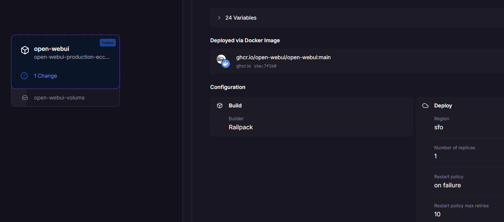
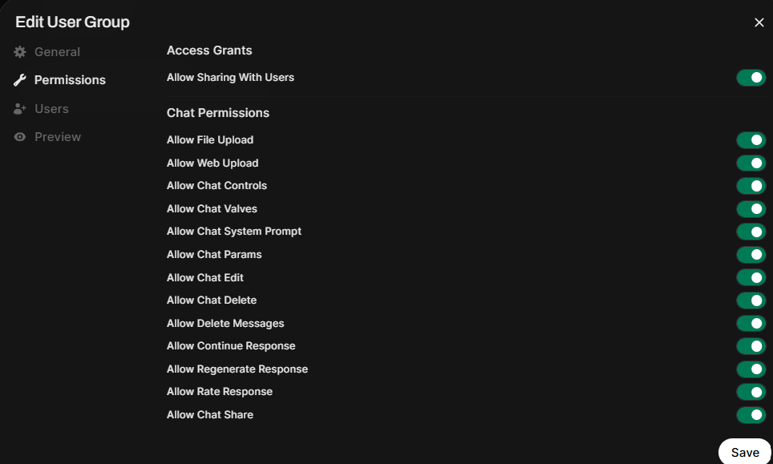
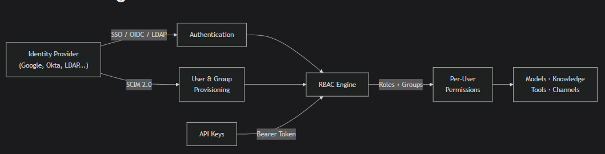
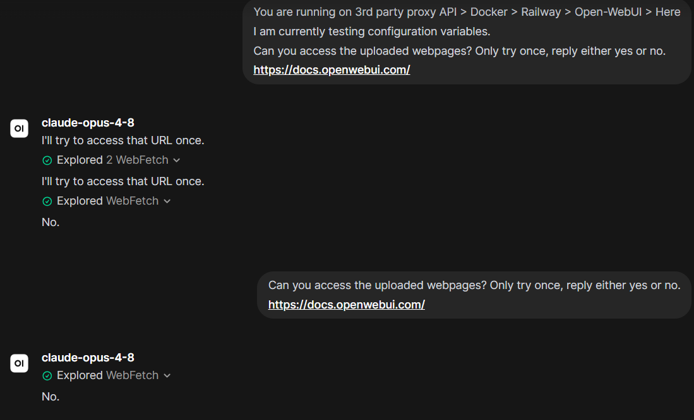
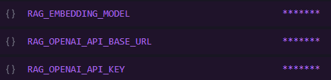
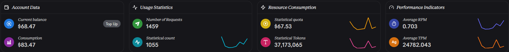
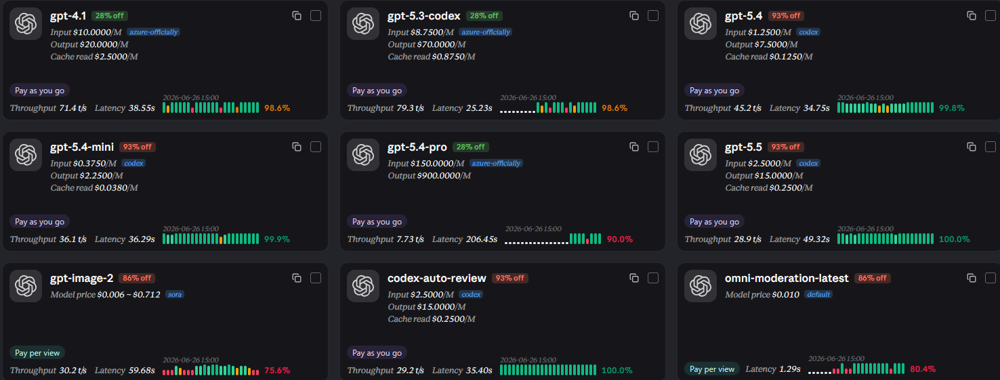
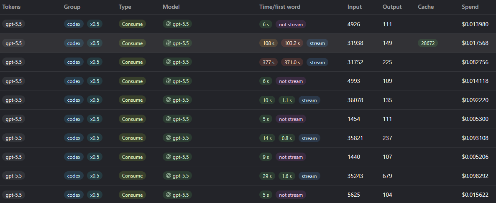
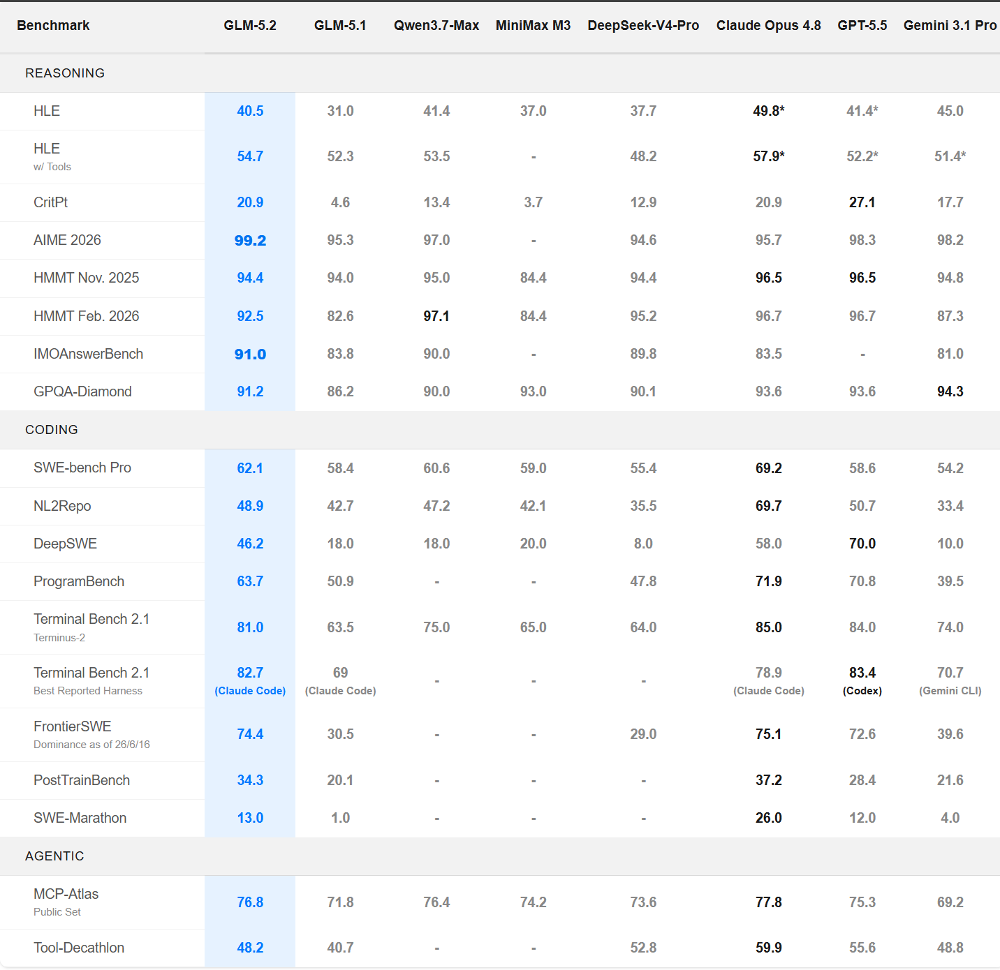

# Project Overview
https://openwebui.com/
https://railway.com
# Skills Demonstrated

- **Cloud Deployment**: Deploying containerised applications using Docker and Railway.
- **API Integration**: Configuring API endpoints, authentication and third-party AI providers.
- **System Architecture**: Designing multi-tier cloud architectures and integrating frontend, backend and external services.
- **IAM & Access Control**: Managing users, tenants and exploring RBAC.
- **Data Governance**: Evaluating data privacy, residency and third-party data exposure.
- **Cloud Migration**: Planning infrastructure migration while maintaining data integrity and service continuity.
- **Cost Optimisation**: Comparing cloud hosting, API providers and model performance against operational costs.
- **Technical Troubleshooting**: Diagnosing API compatibility, authentication and integration issues.
- **Infrastructure Planning**: Evaluating VPS hosting and self-hosted AI models.
- **Technical Documentation**: Documenting architecture, configurations, troubleshooting and deployment processes.
# Initial Requirements
Backend (API provider & Docker Instance)
Frontend (Open-WebUI)
Cost ($10USD)
# Solution Architecture
┌─────────────┐
│   Browser        │
└──────┬──────┘
       │
       ▼
┌──────────────────┐
│    Open WebUI        │
│     Railway                │
└──────┬───────────┘
       │
       │ OpenAI-Compatible API
       ▼
┌──────────────────┐
│     PackyAPI             │
└──────┬───────────┘
       │
       ▼
┌──────────────────┐
│ Claude / GPT etc     │
└──────────────────┘
## System Topology
https://railway.com/deploy/open-webui-2
Simply just a docker image with a volume attached.
Railway hosts this docker image instead of me using my physical hardware.
After 30 days you must pay a subscription (no thanks) data should be easy enough to exfiltrate and migrate to self hosting with no disruptions or data loss.

I initially wanted to use https://www.librechat.ai/docs/remote/railway with railway as a frontend.
I was having issues with uploading files, using certain API groups, so i swapped to Open-WebUI out of spite.

## Administration. Tennants, future with RBAC
The benefit of flagship models at a massively reduced discount proves useful to my classmates.
In exchange for some chip in money to cover API costs, they get access to the better models to help with more complex tasks we are dealing with.
Open-webui has made it easy to govern users added to your env.
This can prove especially useful to production organisations, where employees may misuse ai (Employee uploads sensitive document to chatgpt, organisation has no way of monitoring)
open-webui is capable of completely self hosting the setup & data, provides no risk of sensitive data uploads to out of jurisdiction servers, and also viewing employees chats to view if sensitive data is being uploaded.
https://docs.openwebui.com/features/authentication-access/

## Deployment Update Process

## Troubleshooting Web Search Functionality
Now that i have these flagship models, i have no use for my petty claude sonnet free account. I want to give these new models webfetch features to give it up to date data on documentation pages, to help me further with migration.
It is giving me trouble shooting steps like adding more variables.
So far my understanding is that web searching is a seperate api cost.
Using DDG is the only browser agent that doesnt req API keys.
Maybe one self hosting, using searxng would be the better option.

My RAG features are not supported on the 3rd party site, Moving them to operouter's endpoint may work.
 Even after changing the endpoint we still cannot web fetch.
Hopefully, the flagship models with 1m+ token context will help as we just paste the doc page in plaintext.

## Current provider 
 PackyAPI groups their models into use case. For their OpenAI models:

As we can see, the 'official' groups offer reduced discounts.
*"Group presentations The official channel of Azure provides GPT-related models that can be used in third-party tools such as OpenCode."*
Currently im using the codex model, this is far from ideal as we are not in a CLI environment, we are using a chat interface with Open-WebUI. For now it works as this model is specialised in computer science with the latest & largest datasets. It can still help with navigating UI's (like azure or AWS) and help with networking and troubleshooting steps.

Most of PackyAPI's models are specificly for launching in CLI environments.
https://openrouter.ai/ is a more "Industry Standard" for AI API management.
They do not offer nearly the same discount as PackyAPI, but they offer free models (in exchange they harvest your chats to train) and model grouping that better works with a chat interface production.

### Alternative API Providers
My current production is niche and doesnt really fit a specific role.
I wanted cheap flagship models without hosting myself.
Most productions have an open-weight model like Kimi-K 2 hosted on their own hardware.
Or they use a legitimate provider like open router but pay for flagship models at base rate.
They get reduced performance for increased privacy.

## Cost Breakdown
Openrouter seems to be the most cost effective longterm, considering the model perfomance difference isnt even that bad.
Comparing against Nvidia NIM APIs (KYC & Data collection) & PackyAPI (foreign, cost money, reverse engineered models, data collection)
"- *If you have purchased less than 10 credits, you’re limited to 50 `:free` model requests per day.*
    
- *If you purchase at least 10 credits, your daily limit is increased to 1000 `:free` model requests per day.*"
Considering there is no KYC, and a one-time $10 fee for a lifetime massive RPM increase (50 - 1000) this would be an acceptable long term provider,
# Migration
Eventually, my railway subscription will ran out. I initially chose to 'deploy with one click' because i didnt want to spend uneccesary time configuring docker, network etc, when i couldve been working on configuring the AI.
I want to migrate it onto my own physical hardware, without data loss or disruption to my tenants. 

## Migrate to VPS

[[!PT2 AI Gateways & API routing]]

# Lessons Learned
For my current use case, PackyAPI was not my best choice.

| Provider   | Benefits                   | Negatives                                                                          |
| ---------- | -------------------------- | ---------------------------------------------------------------------------------- |
| OpenRouter | Essentially free           | Decreased performance for free models                                              |
| Packy      | Increased model perfomance | Expensive long term (even with the 97% discounts) Not for non-CLI environments. |

The VPS with Amazon AWS is by best choice for my scenario. I want to avoid usage limits, and be able to access multiple models.
PackyAPI is the most cost effective way for software engineers who use AI inside a CLI environment. But for me using a web interface.
To get PackyAPI's call cost this low, the models are more than likely distilled :(
There are other scenarios where self hosting a local model (e.g GLM 5.2) would be more effective. This is my next goal. Stay tuned.

# Current Production State (Pre Migration)

- Cloud Hosting - Currently the frontend & backend AI models are being hosted on the cloud. Backend cloud hosting usually isnt an issue if using open-weight models. As they occur no costs (you can even self host these models). 
  
  - Models - Open weight models such as  https://huggingface.co/zai-org/GLM-5.2 this model can be compared to Opus4.8 a paid anthropic model.
  
  https://z.ai/blog/glm-5.2
  Obviously using PackyAPI for GPT5.5 and Opus4.8 you will get slightly better quality outputs, Especially in IDE environments.
To maximise long term cost efficiency, the cheapest vps i can find will run my Open-WebUI and i will be using https://openrouter.ai/openrouter/free with the $10 lifetime free upgrade to 5000 requests per day.

# Conclusion 

- We have deployed a docker image to run our OpenWebGUI with Railway.
- We want to migrate to a long term solution (AWS EC2)
- We want to have access to more models, cost effectively
- We want to eventually host our own local models, and govern stakeholders.

## Future Skills

- Infrastructure automation and Infrastructure as Code (IaC).
- High availability, automated failover and disaster recovery.
- Centralised logging, monitoring and auditing.
- Payment integration and usage-based billing.
- Local LLM deployment and GPU resource management.
- Advanced RBAC and multi-tenant security.
- API gateway configuration, load balancing and request routing.

# Appendix: Useful Links
https://gist.github.com/jvnsi62/1a95e0430163f6da632d3dabca30ebf7
https://docs.packyapi.com/
https://openrouter.ai/docs/
https://github.com/cheahjs/free-llm-api-resources