# VPS Migration
We have migrated from the original Railway docker deployment, as this is not a sustainable long term solution.

## AWS Setup
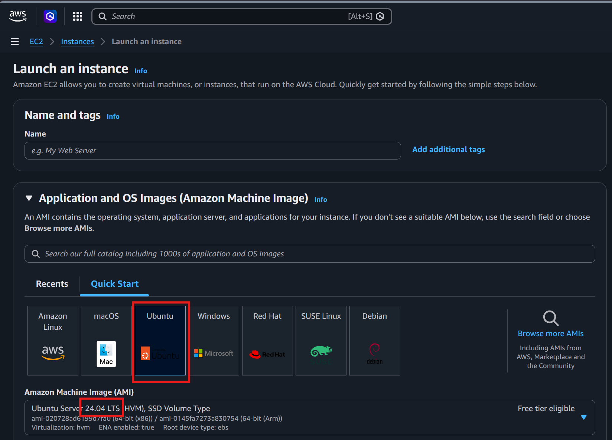
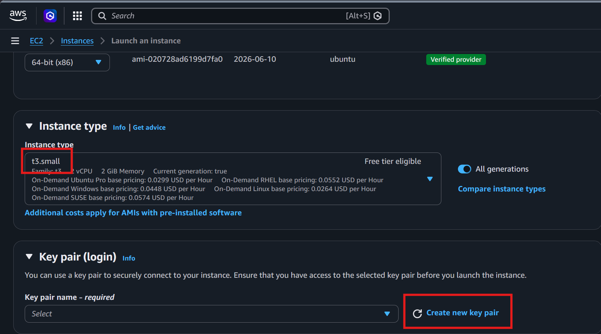
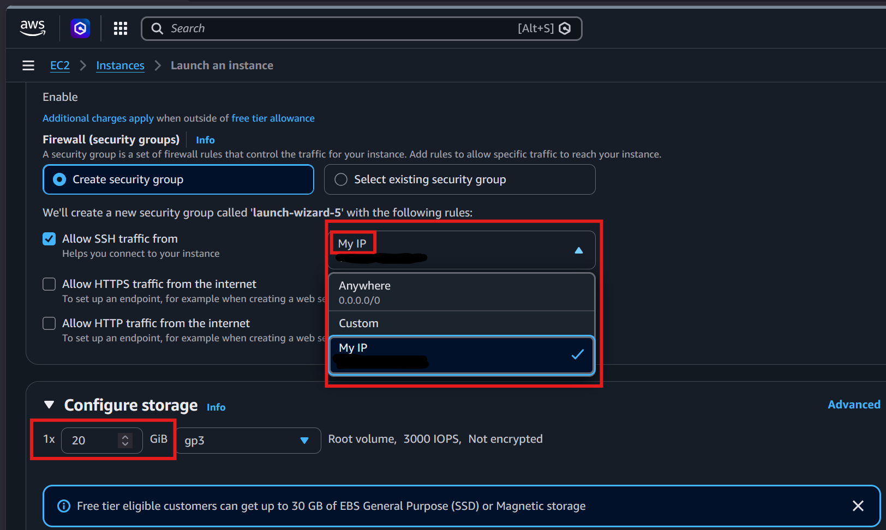

## SSH & Docker install
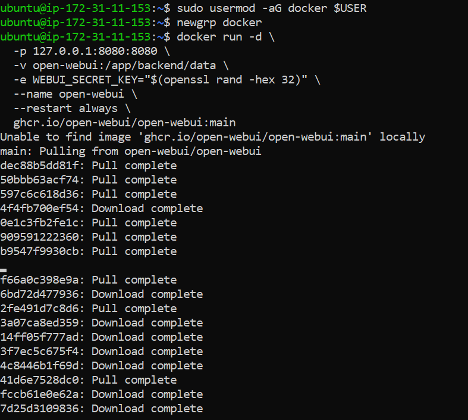
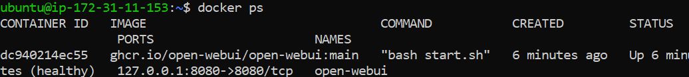

## Ngrok install
`curl -sSL https://ngrok-agent.s3.amazonaws.com/ngrok.asc \`
  `| sudo tee /etc/apt/trusted.gpg.d/ngrok.asc >/dev/null \`
  `&& echo "deb https://ngrok-agent.s3.amazonaws.com bookworm main" \`
  `| sudo tee /etc/apt/sources.list.d/ngrok.list \`
  `&& sudo apt update \`
  `&& sudo apt install -y ngrok`

Add your authtoken
`ngrok config add-authtoken <YOUR_AUTHTOKEN>`

Start the tunnel (test run — Ctrl+C to stop)
`ngrok http --url <your-domain>.ngrok-free.app 8080`

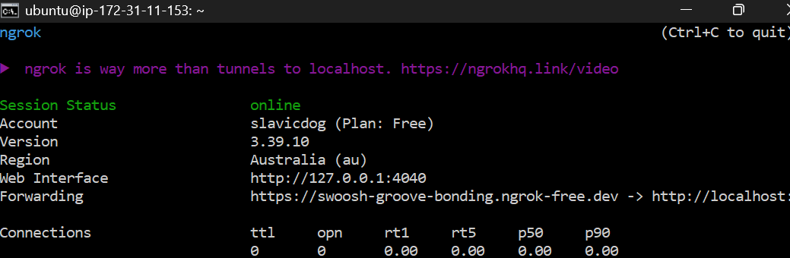 

### Test Installation
We can access our free temporary domain from ngrok:
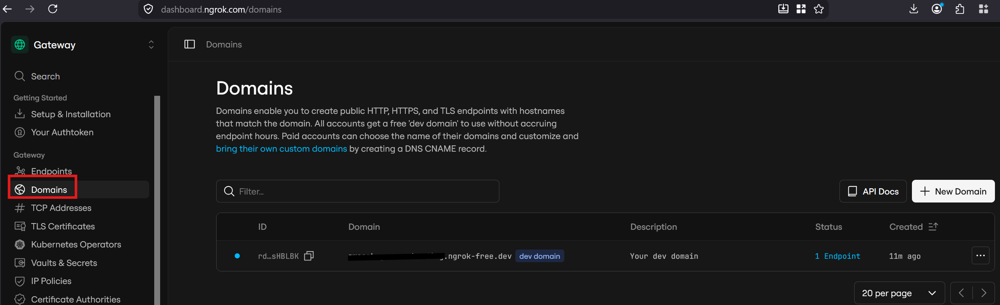
After pasting the URL into the browser, we can see the tunnel has picked up requests, and Open-webui homepage loaded.
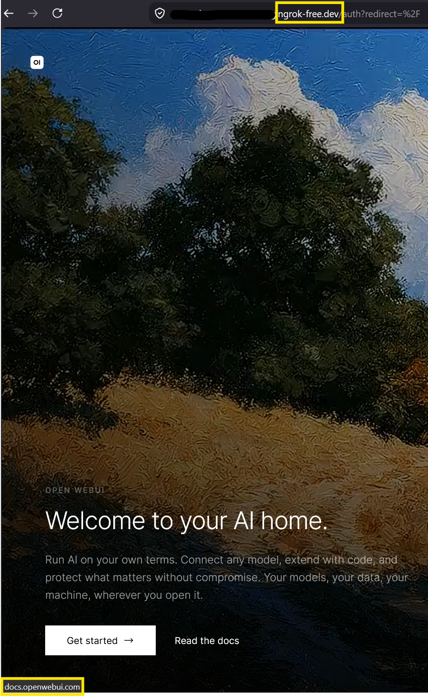
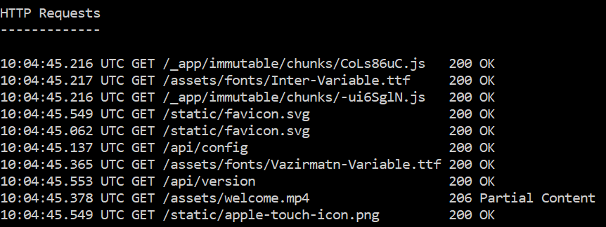

The initial migration for hosting open-webui on a remote linux machine (AWS) has been completed.

# Setup Open-webUI & Models 
Our first step is to claim a free API key from https://openrouter.ai/ and input it into our open WebUI Admin panel
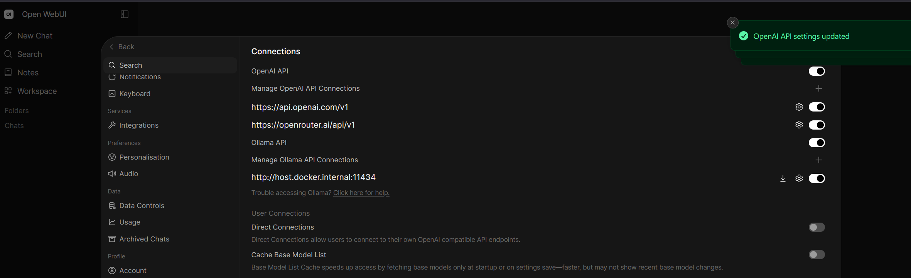
We can confirm our key works by selecting a free model from OpenRouter, and selecting it in Open-WebUI
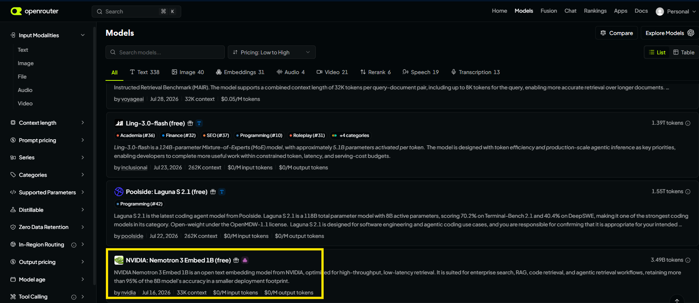
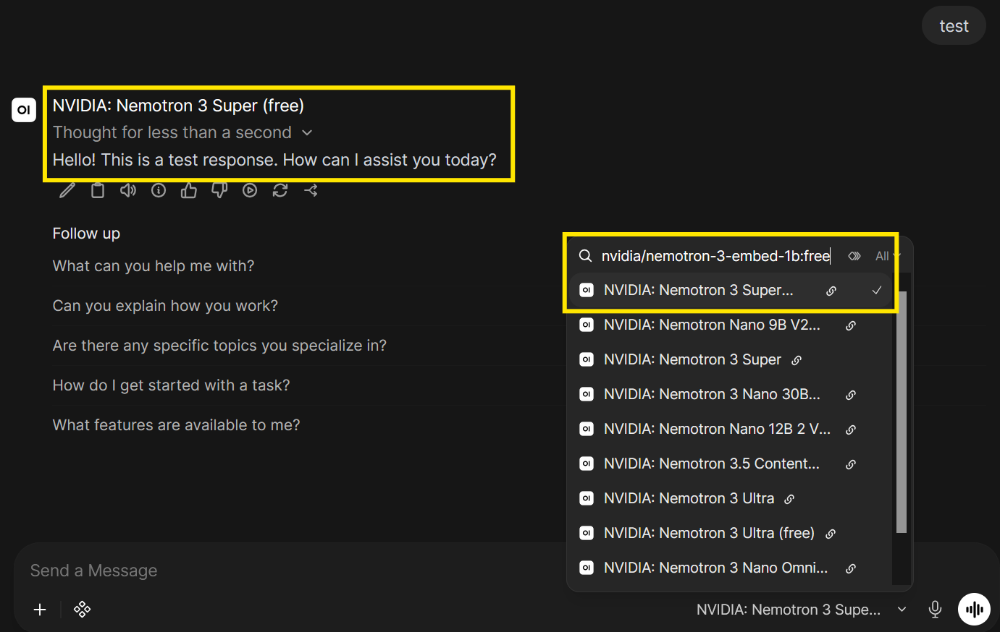
Now, why have we gone through all this effort to set up a VPS, docker, API etc, when openrouter already has a GUI interface to access their models, RAG setup (input images, URLS)
The answer is: We are doing this to get access to as many models as possible, at the lowest possible price. OpenRouter is just 1 API provider, we can stack multiple providers together to our Open-WebUI, and increase our free tokens per month, along with other AI models. (OmniRouter)
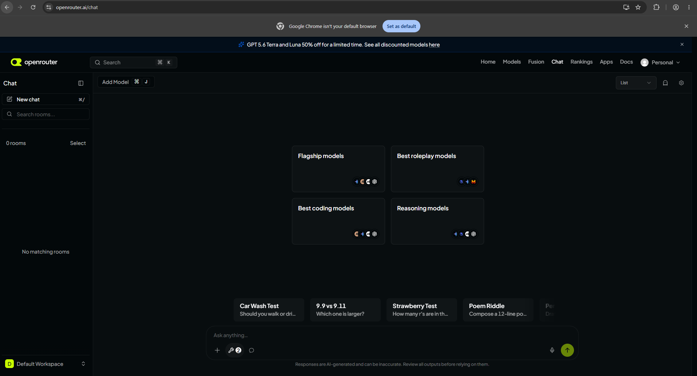
*OpenRouter's GUI chat interface*
## Server Tools
Before we move onto other providers, we need to give our AI access to server tools, such as webfetch, image generation etc. https://openrouter.ai/docs/guides/features/server-tools#how-server-tools-work

| ***Tool***                                                                                         | ***Type***                                 | ***Description***                                                         |
| -------------------------------------------------------------------------------------------------- | ------------------------------------------ | ------------------------------------------------------------------------- |
| *[**Web Search**](https://openrouter.ai/docs/guides/features/server-tools/web-search)*             | *`openrouter:web_search`*                  | *Search the web for current information*                                  |
| *[**Datetime**](https://openrouter.ai/docs/guides/features/server-tools/datetime)*                 | *`openrouter:datetime`*                    | *Get the current date and time*                                           |
| *[**Image Generation**](https://openrouter.ai/docs/guides/features/server-tools/image-generation)* | *`openrouter:image_generation`*            | *Generate images from text prompts*                                       |
| *[**Web Fetch**](https://openrouter.ai/docs/guides/features/server-tools/web-fetch)*               | *`openrouter:web_fetch`*                   | *Fetch and extract content from URLs*                                     |
| *[**Apply Patch**](https://openrouter.ai/docs/guides/features/server-tools/apply-patch)*           | *`openrouter:apply_patch`*                 | *Propose file edits via V4A diff patches (Responses API only)*            |
| *[**Shell**](https://openrouter.ai/docs/guides/features/server-tools/shell)*                       | *`openrouter:shell`*                       | *Run commands in a hosted, sandboxed shell (Responses and Messages APIs)* |
| *[**Fusion**](https://openrouter.ai/docs/guides/features/server-tools/fusion)*                     | *`openrouter:fusion`*                      | *Run a panel of models and an analyst for multi-model analysis*           |
| *[**Advisor**](https://openrouter.ai/docs/guides/features/server-tools/advisor)*                   | *`openrouter:advisor`*                     | *Consult a stronger model for guidance mid-generation*                    |
| *[**Subagent**](https://openrouter.ai/docs/guides/features/server-tools/subagent)*                 | *`openrouter:subagent`*                    | *Delegate self-contained tasks to a smaller, faster worker model*         |
| *[**Search Models**](https://openrouter.ai/docs/guides/features/server-tools/search-models)*       | *`openrouter:experimental__search_models`* | *Search and filter the OpenRouter model catalog*                          |
*OpenRouters [Available Server Tools*](https://openrouter.ai/docs/guides/features/server-tools#available-server-tools)
This issue was one of the bottleneck last time when we deployed on Railway.
We want more than just a sentence prediction robot.

# Security 

| Feature                 | Railway (SaaS)                                                                        | AWS (IaaS)                                                        |
| ----------------------- | ------------------------------------------------------------------------------------- | ----------------------------------------------------------------- |
| Infrastructure security | Railway manages underlying hosting infrastructure.                                    | AWS manages physical infrastructure and virtualisation.           |
| Network security        | Railway manages platform and security patches                                         | Customer is responsible for OS updates and security patches.      |
| Identity management     | Built-in user management and application-level access controls (also with OpenWebGUI) | AWS IAM users, groups, roles and policies.                        |
| Authentication          | Open WebUI authentication and Railway account access controls.                        | SSH key authentication, IAM and application-level authentication. |
| Data encryption         | Encrypted platform communications and supported database encryption options.          | EBS encryption and AWS KMS key management.                        |
| Monitoring              | Integrated application logs, infrastructure metrics and database observability.       | CloudWatch, CloudTrail and other AWS security services.           |

# Backup & Disaster Recovery

https://railway.com/guides/first-class-databases-on-railway
https://docs.aws.amazon.com/AWSEC2/latest/UserGuide/ec2-security.html
https://docs.aws.amazon.com/aws-backup/latest/devguide/data-protection.html

| Feature                 | Railway (SaaS)                                                           | AWS (IaaS)                                                     |
| -------------------------- | ------------------------------------------------------------------------ | -------------------------------------------------------------- |
| **Automated backups**      | Scheduled backups for supported managed databases.                       | Automated backups using AWS Backup.                            |
| **Point-in-time recovery** | Available for supported managed PostgreSQL and MySQL databases.          | EBS snapshots and AMI creation.                                |
| **Backup retention**       | Configurable                                                             | Configurable retention policies using AWS Backup.              |
| **Data restoration**       | Restore backups into separate database instances.                        | Restore EBS volumes and EC2 instances from snapshots and AMIs. |
| **Disaster recovery**      | Managed availability and database failover for supported configurations. | Cross-region backups, replication and multi-AZ architectures.  |

# Other
## Limits & Token Usage
Once the production expands and more uses connect, our costs or rate limits will increase.
Currently PackyAPI is not connected and we are solely utilising OpenRouter's free $10 lifetime request increase to 1000 requests a day for free models.

[Omni route](https://github.com/diegosouzapw/OmniRoute#-290-ai-providers--90-free) - Stack multiple API providers (like OpenRouter) into a single endpoint.
Onmi-route is pretty much an expanded list of providers to OpenRouter's already existing [Free Models Router](https://openrouter.ai/docs/cookbook/get-started/free-models-router-playground).

| *Metric*                                      | *Tokens / month*    | *Meaning*                                                                                                                                                                                                                                                |
| ------------------------------------------- | ----------------- | ------------------------------------------------------------------------------------------------------------------------------------------------------------------------------------------------------------------------------------------------------ |
| ***Documented recurring grant (steady)***     | ***~1.53B***        | *Free-tier **pools** (per-model catalog), each shared pool counted **once**. The live source behind `/api/free-tier/summary` and the dashboard's Free-Tier Budget page. **Use this number.***                                                            |
| ***+ first month with signup credits***       | ***~2.15B***        | *Steady + one-time signup credits (Together $25, Z.AI 20M, DeepSeek 5M, …), deduped per account. **First month only** — does not recur.*                                                                                                                 |
| ***+ permanently free, no published cap***    | *un-quantifiable* | *`siliconflow`, `glm-cn` (GLM-4-Flash), `tencent`, `baidu`, `kilo-gateway`, `opencode-zen` — real recurring access, rate/concurrency-limited, **no token cap to count**. Listed, never summed (counting them at `RPM×24/7` is the inflation we reject).* |
| ***+ deposit-unlock boost***                  | ***+~24M***         | *A one-time **$10** OpenRouter top-up raises its free pool from 50 → 1000 req/day. Reported separately so it never inflates the steady number.*                                                                                                          |
| *Theoretical ceiling (all rate limits, 24/7)* | *~10B*              | *Sum of every provider rate limit extrapolated to non-stop use. **Not a guarantee** — do not headline this.*                                                                                                                                             |
- https://github.com/diegosouzapw/OmniRoute/blob/release/v3.8.49/docs/reference/FREE_TIERS.md#tldr--how-much-free-inference-does-omniroute-actually-aggregate

## Model Additions
As mentioned before, what is the point of going through all this added effort when OpenRouter has its own GUI interface for the models they provide?
The answer is we want our interface to be a large model router that we can fully govern. We want to combine multiple providers together, to maximise our tokens cost effectivly, or even run our own models and use it safely whithin an organisation.
We can download our own local models from https://huggingface.co/ 
And use these other providers below:
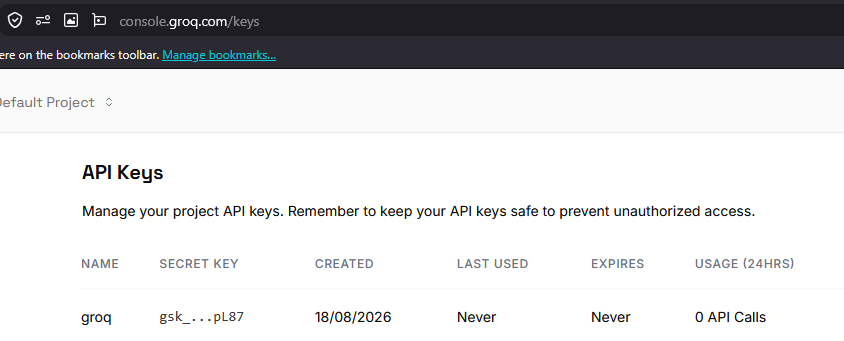
- groq.com
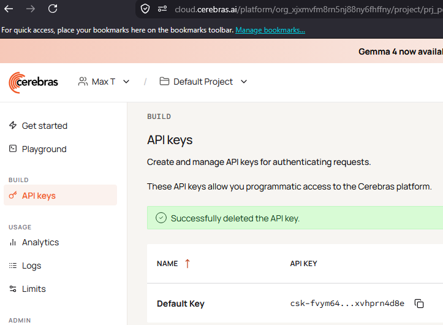
- cerebras.ai
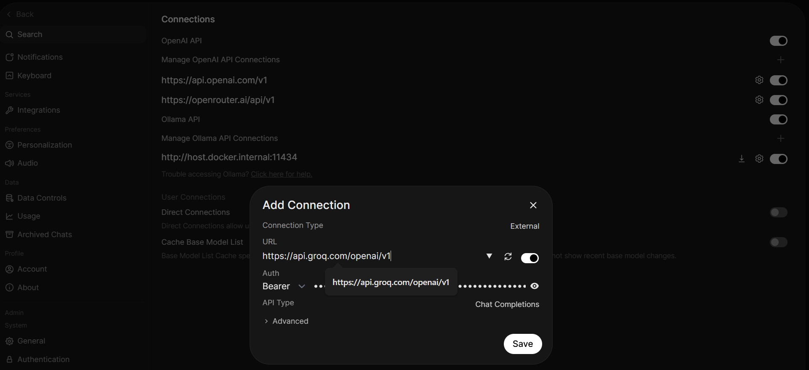
- *Adding the new API keys to Open-WebUI*

## Troubleshooting

| ==Keep ngrok alive== `sudo nano /etc/systemd/system/ngrok.service` ==change== `ExecStart=/usr/bin/ngrok http --url swoosh-groove-bonding.ngrok-free.dev 8080` ==to== `ExecStart=/usr/local/bin/ngrok http --url swoosh-groove-bonding.ngrok-free.dev 8080`                                                                                                                                  |     |
| ------------------------------------------------------------------------------------------------------------------------------------------------------------------------------------------------------------------------------------------------------------------------------------------------------------------------------------------------------------------------------------------------------------- | --- |
| **==Docker Install==** `curl -fsSL https://get.docker.com \| sudo sh` `sudo usermod -aG docker $USER` `newgrp docker`                                                                                                                                                                                                                                                                                |     |
| **==Open WebUI==** `docker run -d \`   `-p 127.0.0.1:8080:8080 \`   `-v open-webui:/app/backend/data \`   `-e WEBUI_SECRET_KEY="$(openssl rand -hex 32)" \`   `--name open-webui \`   `--restart always \`   `ghcr.io/open-webui/open-webui:main`                                                                                                                                        |     |
| **==Ngrok Install==** `curl -sSL https://ngrok-agent.s3.amazonaws.com/ngrok.asc \`   `\| sudo tee /etc/apt/trusted.gpg.d/ngrok.asc >/dev/null \`   `&& echo "deb https://ngrok-agent.s3.amazonaws.com bookworm main" \`   `\| sudo tee /etc/apt/sources.list.d/ngrok.list \`   `&& sudo apt update \`   `&& sudo apt install -y ngrok`  `ngrok config add-authtoken <YOUR_AUTHTOKEN>` |     |

# Conclusion
Again, Openrouter have their own chat GUI. Using OpenWebGUI with OpenRouter by themselves is useless.
To make it worth while we would combine multiple providers, or use a local model on our own hardware, so we can govern the stakeholders usage with the AI, and maximise our tokens per month cost effectively.

## Skills Demonstrated

- **Cloud Deployment**: Deploying containerised applications using Docker and Railway.
- **API Integration**: Configuring API endpoints, authentication and third-party AI providers.
- **System Architecture**: Designing multi-tier cloud architectures and integrating frontend, backend and external services.
- **IAM & Access Control**: Managing users, tenants and exploring RBAC.
- **Data Governance**: Evaluating data privacy, residency and third-party data exposure.
- **Cloud Migration**: Planning infrastructure migration while maintaining data integrity and service continuity.
- **Cost Optimisation**: Comparing cloud hosting, API providers and model performance against operational costs.
- **Technical Troubleshooting**: Diagnosing API compatibility, authentication and integration issues.
- **Infrastructure Planning**: Evaluating VPS hosting and self-hosted AI models.
- **Technical Documentation**: Documenting architecture, configurations, troubleshooting and deployment processes.
## Future Skills

- Infrastructure automation and Infrastructure as Code (IaC).
- High availability, automated failover and disaster recovery.
- Centralised logging, monitoring and auditing.
- Payment integration and usage-based billing.
- Local LLM deployment and GPU resource management.
- Advanced RBAC and multi-tenant security.
- API gateway configuration, load balancing and request routing.

