The project uses AWS CloudTrail to record API activity, Amazon EventBridge to detect a specific AWS STS event, and Amazon SNS to send email notifications when the event occurs. A Kali Linux machine is then used to simulate attacker activity through the AWS CLI.
The project demonstrates practical skills in AWS security monitoring, cloud logging, event detection, automated alerting, and analysis of security events.

## Setting up AWS account & Creating notification service
We will be using amazons cloud computing service for this demonstration https://aws.amazon.com/
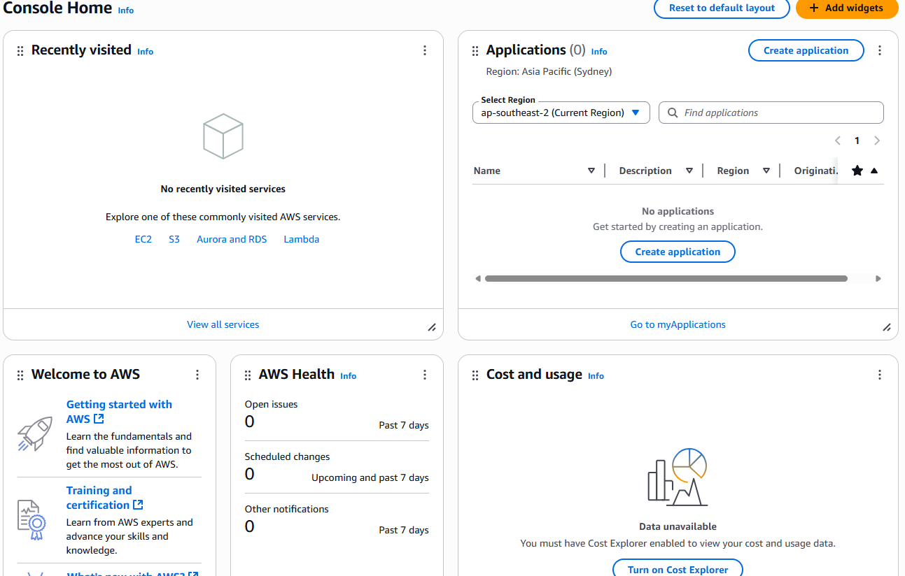
Once the account has been created, we will now setup a notification service, we will receive a notification anytime attacker activity is detected.
In the search bar [Alt + S] we will look for the "*Simple Notification Service*" module.
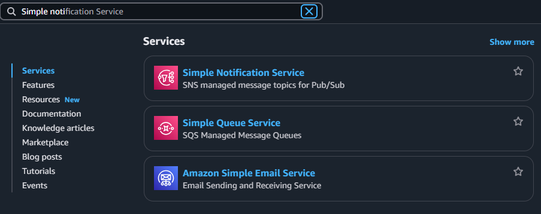
Create a topic name.
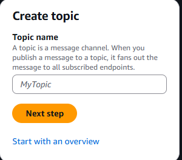
Once we a brought to the next wizard, we can leave everything as default.
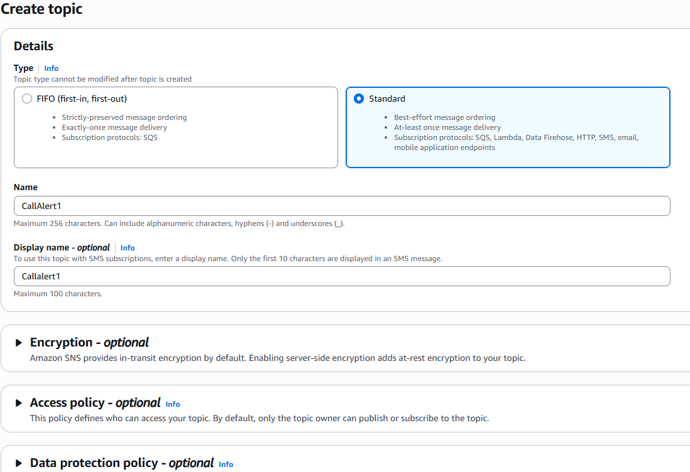
Press Create subscription.
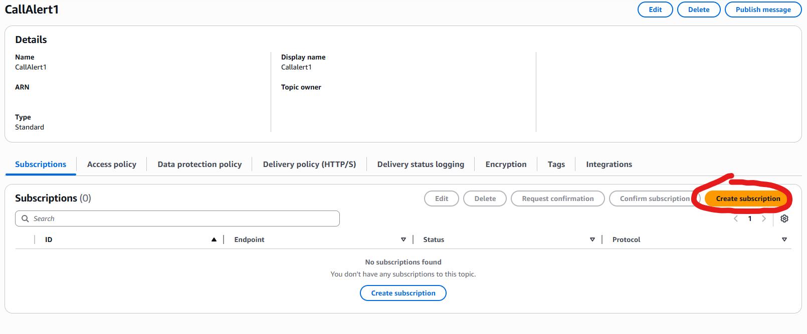
We can now choose the protocol on how we will receive the attacker notification. We will choose email and input the email we want to use to receive the notification.
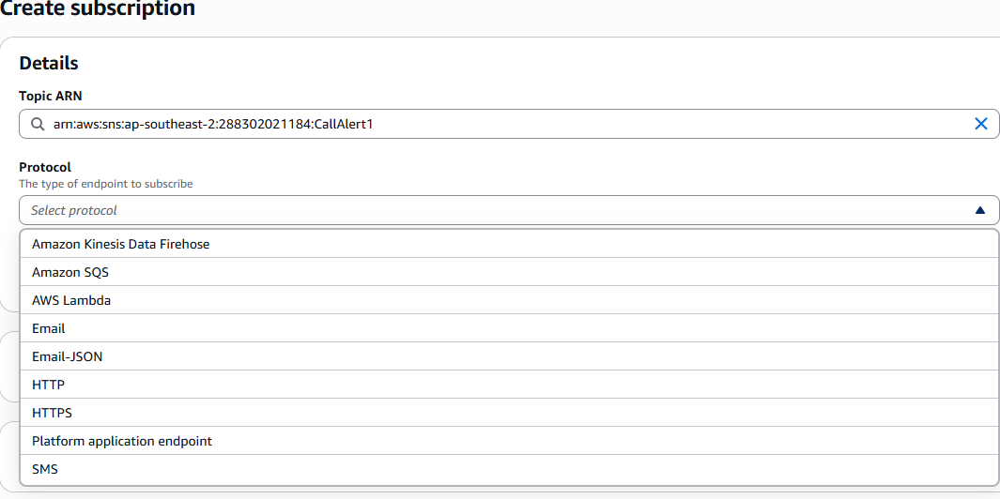
Confirm the subscription in your inbox.
## Setting up CloudTrail
CloudTrail lets us log everything that takes place in our AWS account.
By logging this activity, we are able to detect malicious activity as well as being notified via the notification service.
[Alt + S] and search for CloudTrail
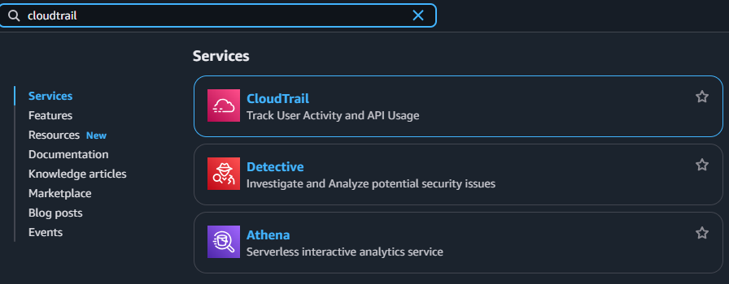
[Create Trail] > [Name Trail] > [Uncheck SSE-KMS Encryption] > [Check SNS notification Delivery] > [Existing SNS Topic]
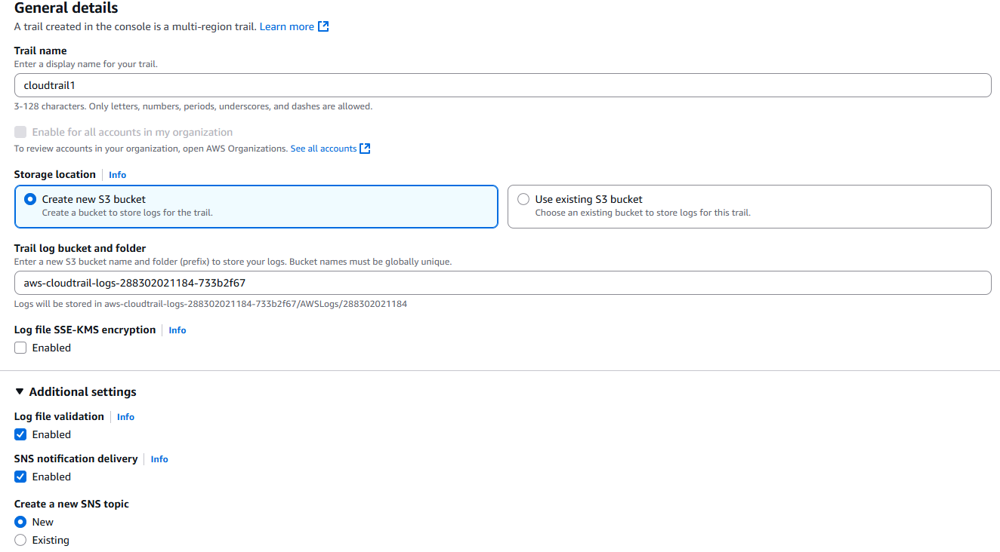
[Next] > [Events Check Management events] > [Check API activity Read & Write]
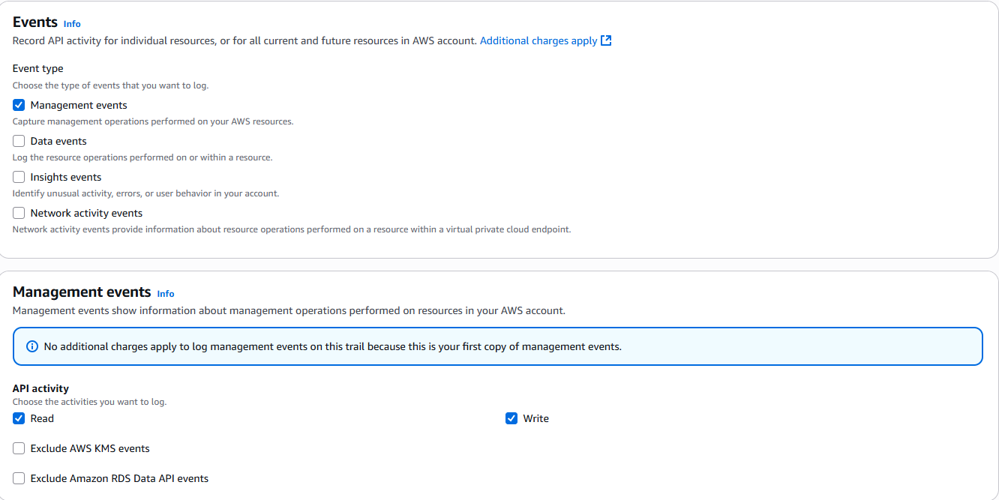
[Next] > [Review Settings] > [Create trail]
## Setting up EventBridge
[Alt + S] Amazon EventBridge > [Rules]

We will be creating a rule to look for a specific type of event called "*Get Caller Identity*". This command is sometimes used by attackers when they get access to a AWS token and is similar to the `whoami` command
[Create Rule] > [Create name] > [Check Rule type Rule with an event pattern]
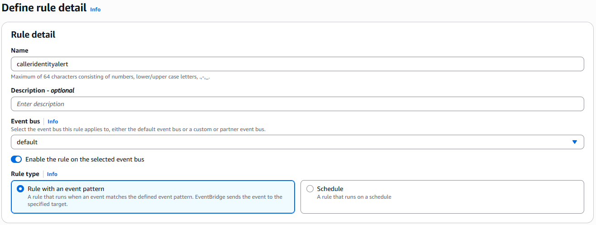
[Next] > [Leave as default] > [Creation method Check Custom pattern (JSON EDITOR)]
Input this json
```
{
  "source": ["aws.sts"],
  "detail-type": ["AWS API Call via CloudTrail"],
  "detail": {
    "eventSource": ["sts.amazonaws.com"],
    "eventName": ["GetCallerIdentity"]
  }
}
```
Line 2 specifies the source the call is coming from
Line 3 indicates event type is recorded by CloudTrail
Line 5 shows relations to sts service used for identity and access management
Line 6 shows the specific API call being made to the STS service (Used by attackers)
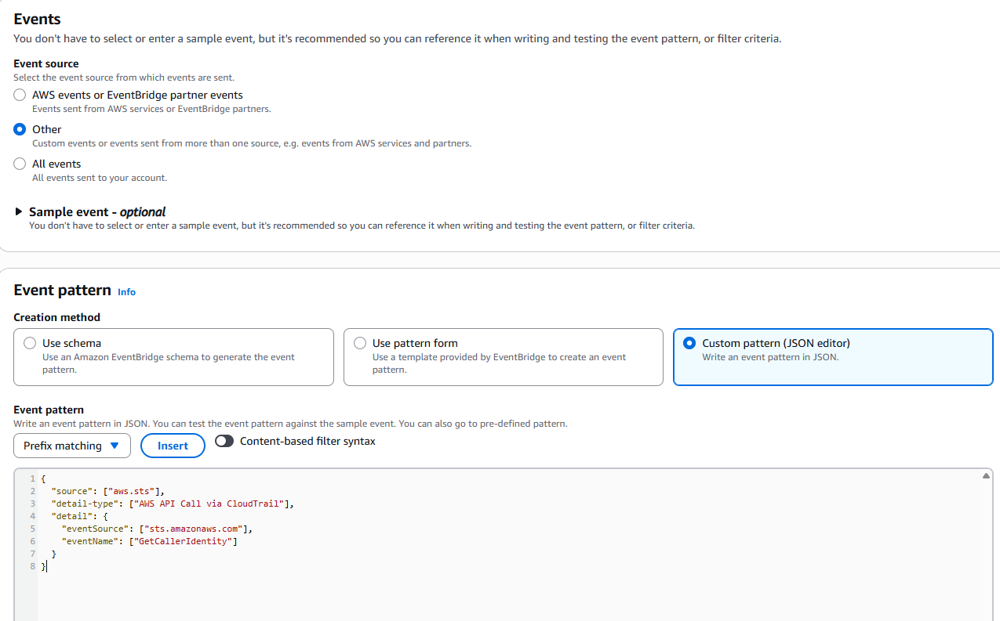
[Next] > [Check AWS service] > [Select target SNS topic] > [Topic (Your named topic)]
[Next] > [Create Rule]
## Running attacker commands
Our goal on our kali machine is to connect to the AWS infrastructure and run the getcoreidentity command to test if our notification setup is working.
`aws configure`
It will ask for AWS Access Key ID
For demonstrating purposes I will be using a root user access key. This is not a good practice to use in a working environment.
Go to the AWS console home
[Press top right account name] > [Security credentials] > [Access keys] > [Create access key] > [Create access key] > [Copy access key & paste into linux] > [Copy secret access key & paste into linux] > [Go back to main AWS page] > [Top right and find what region is being used & paste into linux] > [Set default output to JSON in linux] > [Enter]
Our kali machine should now be connected to our AWS account, we can now run the caller identity command.
`aws sts get-caller-identity`
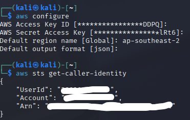
We have now ran the command that our notification tool has been configured to detect. If we check the email that was configured to recieve notifications we should be able to find the logs.
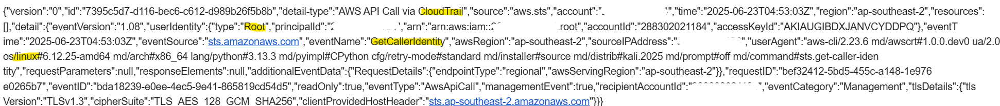
Shown by the highlighted text, we can see the command that was sent `getcalleridentity` and the machine information that the command was sent from 'linux' 


## Conclusion
This project demonstrated how AWS security monitoring can be configured to detect and alert on specific API activity. We configured AWS CloudTrail to record AWS API activity, created an Amazon EventBridge rule to detect the `GetCallerIdentity` API call, and connected the rule to Amazon SNS to send an email notification.
We then used the AWS CLI from a Kali Linux machine to simulate suspicious activity by running `aws sts get-caller-identity`. The resulting activity was recorded by CloudTrail, detected by EventBridge, and delivered as an email alert through SNS.
- AWS cloud administration
- AWS CLI usage
- IAM and access-key management
- Cloud security monitoring
- Log analysis
- Event detection and filtering
- Security alerting
- Threat detection and attacker simulation
- Incident/event analysis
- JSON configuration
- Kali Linux
**AWS SERVICES**
- **Amazon CloudTrail**  - records AWS API activity and management events
- **Amazon EventBridge**  - detects specific CloudTrail events using event patterns
- **Amazon SNS (Simple Notification Service)**  - sends security alerts via email
- **AWS STS (Security Token Service)**  - used for `GetCallerIdentity` identity verification
- **AWS IAM**  - manages AWS identities, permissions, and access keys
- **AWS CLI** - command-line interface used to interact with AWS services