# Intro
This project demonstrates how to securely store and manage data in an Amazon S3 bucket using AWS security practices. It includes configuring bucket policies, enabling encryption, setting up access logging, and verifying secure access controls to protect sensitive information.
# Create S3 Bucket
Enable Bucket Versioning
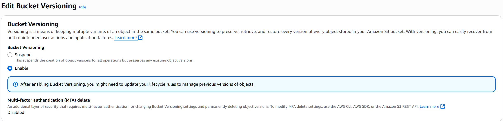

## Enable Encryption
1. Navigate to the S3 Dashboard.
2. Select the bucket `my-secure-bucket`.
3. Click on "Properties".
4. Scroll down to "Default encryption" and click "Edit".
5. Enable server-side encryption with AWS-KMS.
6. Choose a KMS key or create a new one.
7. Save changes.
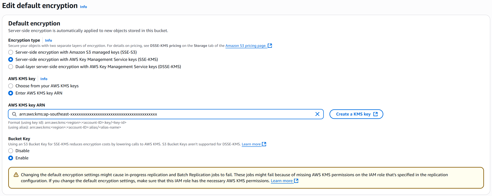
## Set Permissions & Policies
1. Navigate to the S3 Dashboard.
2. Select the bucket `bucket-name`.
3. Click on "Permissions".
4. Scroll down to "Bucket policy" and click "Edit".
5. Add the following policy to allow read access for a specific user or root
`{`
  `"Version": "2012-10-17",`
  `"Statement": [`
    `{`
      `"Effect": "Allow",`
      `"Principal": {`
        `"AWS": "arn:aws:iam::123456789012:user/username"`
      `},`
      `"Action": "s3:GetObject",`
      `"Resource": "arn:aws:s3:::my-secure-bucket/*"`
    `}`
  `]`
`}`
If an error occurs, change `"AWS": "arn:aws:iam::123456789012:user/username"` to `"Principal": { "AWS": "arn:aws:iam::<your-account-id>:root" }`

## Configure Access Logs
1. Navigate to the S3 Dashboard.
2. Select the bucket `my-secure-bucket`.
3. Click on "Properties".
4. Scroll down to "Server access logging" and click "Edit".
5. Enable access logging and specify a target bucket for logs (e.g., `my-log-bucket`).
6. Save changes.
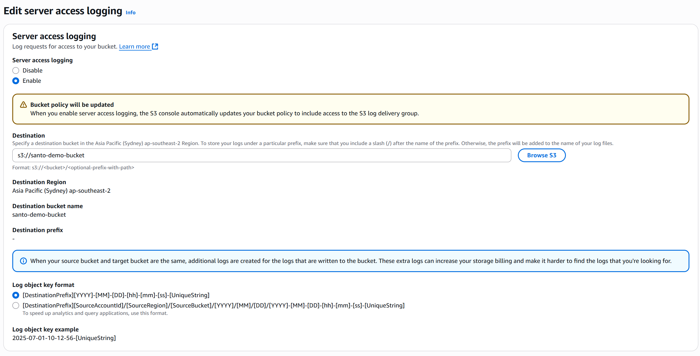
# Create Activity Logs
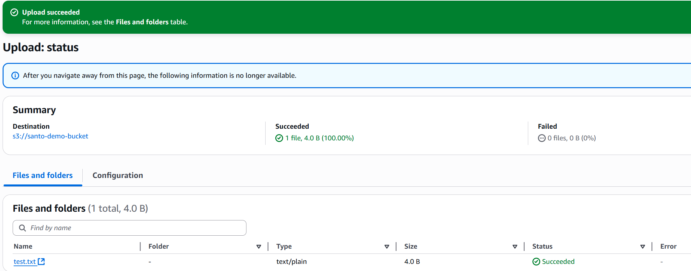
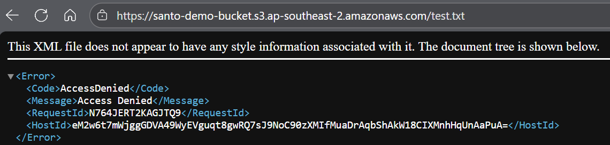
We can see that the file we have uploaded is not publicly visible. An Access Denied request does NOT generate a log.
We download the test file and see if it creates a `GetObject` log
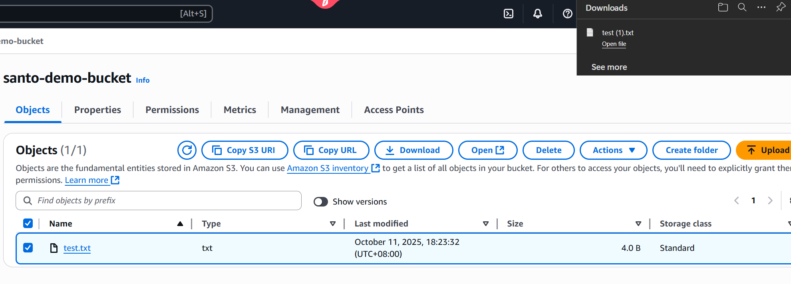
As we can see, there has been a log generated in our seperate Log bucket.
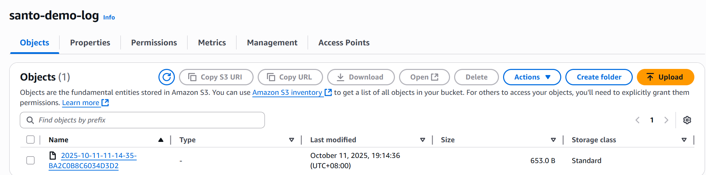

# Make file public
There are many ways to make the https file visible to the public, we will demonstrate a quick way by editing the bucket policy. This is NOT recommended for normal organisational production..
`{`
  `"Effect": "Allow",`
  `"Principal": "*",`
  `"Action": "s3:GetObject",`
  `"Resource": "arn:aws:s3:::my-secure-bucket/test.txt"`
`}`
Usually the policy would have a user or root in "`Principal`" But leaving it empty makes it accessable to the public.
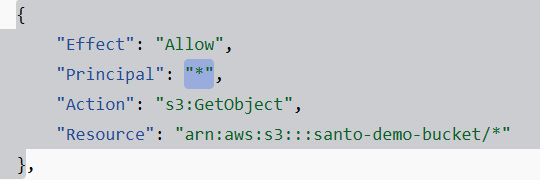
We also need to disable "Block public access"
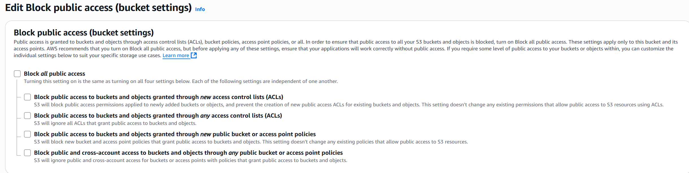
We can see that the file is public, but it is still encrypted
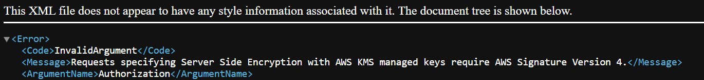
Since we selected SSE-KMS encryption at the start, we change it to SSE-S3
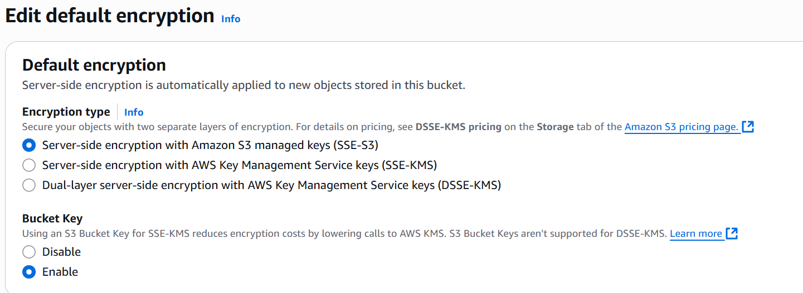
So far, we have 
- Turned off block public access 
- changed the encryption type 
- edited the bucket policy code.

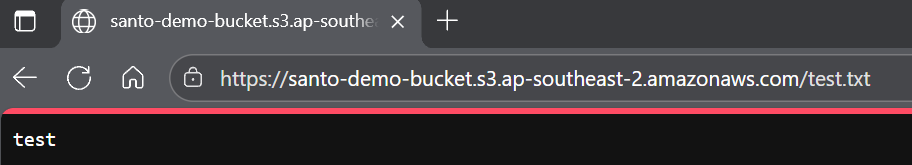
The text is now visible and public to anyone who has this link

# Conclusion
- Successfully created an S3 bucket
- Enabled versioning and server-side encryption
- Set bucket policies
- Configured access logs
- Demonstrated configuration and understanding to securing S3 buckets
