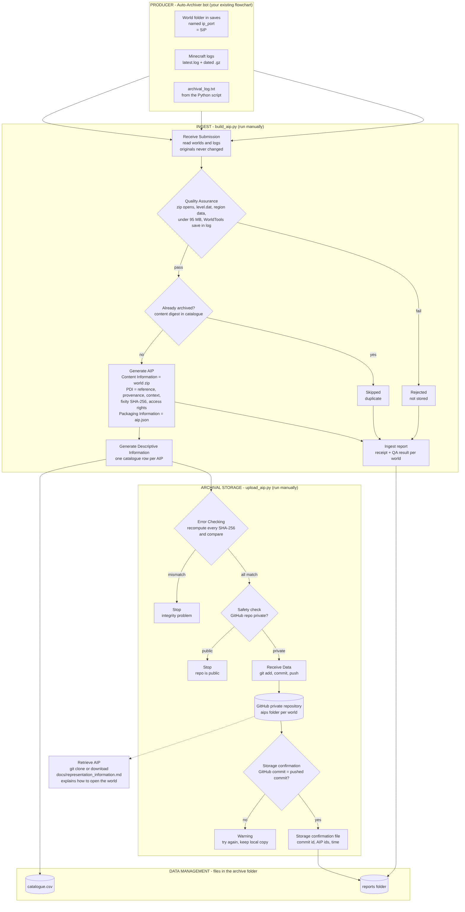
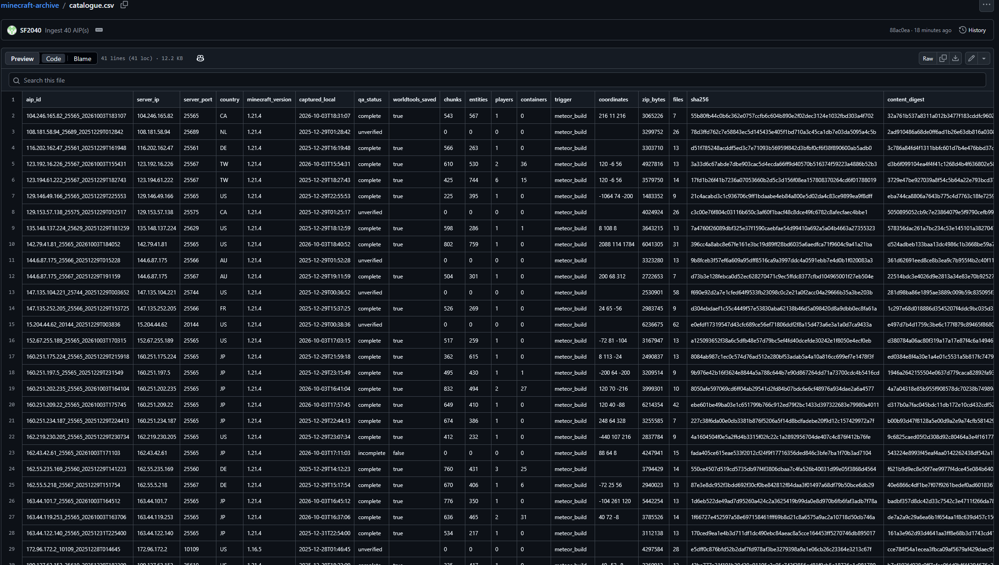
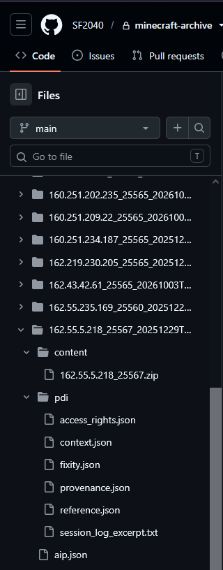
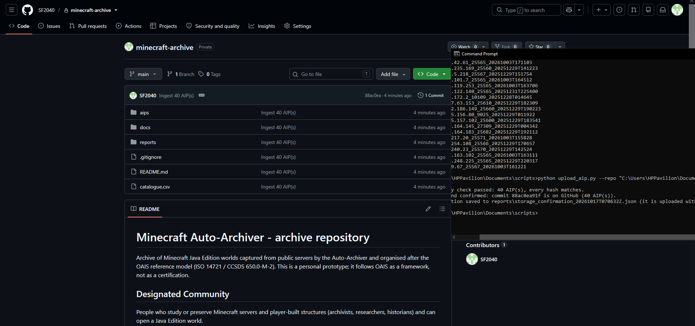

Minecraft Server Archiver

**COMPANION REPOSITORIES**

Report & Documentation

- Part-1: <https://github.com/SF2040/Project-Portfolio/blob/main/Minecraft-Server-Archiver-PT1.md>

- Part-2: <https://github.com/SF2040/Project-Portfolio/blob/main/Minecraft-Server-Archiver-ISO14721-PT2.md>

Builds & Scripts

- Server-Archiver Python script: <https://github.com/SF2040/minecraft-server-archive>

- ISO-14721 AIP: <https://github.com/SF2040/minecraft-archive-AIPUPLOAD>

Other:

- Live demo: <https://youtu.be/6s74uC5A6zg>

- ISO pub: [CCSDS 650.0-M-3](https://ccsds.org/Pubs/650x0m3.pdf)

# Intro
Part 1 of the project is a bot that joins Minecraft servers, detects player builds and downloads the world. Focusing mainly on ingesting data.
Part 2 takes those downloads and preserves them. Aggregating and archiving the data. It packages each world with the information needed to trust and understand it later, checks that nothing has been damaged, and stores it in a  GitHub repository. It follows the OAIS reference model (ISO 14721). The work is done by two small Python scripts that are run by hand after an archiving session. 
These two scripts (`upload_aip.py` & `build_aip.py`) are separate from the main Minecraft PyGUI bot.

# Scope
Inputs from Part 1: the saves folder (one world per server, named by IP address and port), Minecraft’s log files, and the `archival_log.txt` written by the bot.

Part 2 quality checks, packaging into Archival Information Packages (AIPs), a searchable catalogue, upload to GitHub, and confirmation that the upload arrived & was not tampered.

Why is Preservation planning & Access out of scope?
Currently this is a small personal archive, no current designated community or migration planning yet.
# Framework
The OAIS reference model describes how an archive should receive, store and describe digital information so it stays usable over time.  ([CCSDS 650.0-M-3 (December 2024) ISO 14721](https://ccsds.org/Pubs/650x0m3.pdf)) It is used as a framework, not for certification. This is a non-commercial personal project.
The DPC introductory guide notes that “*an OAIS-type archive is still one built primarily on OAIS concepts, not an OAIS suite of standards*”, which is the sense used here.

# System Overview
- `build_aip.py` performs Ingest. It reads the saves folder, the Minecraft logs and `archival_log.txt`, checks each world and builds one AIP per world.
- `upload_aip.py` performs Archival Storage. It re-checks every checksum, pushes the archive to GitHub and confirms that GitHub holds the pushed commit.
  PYTHON 3.12

# Information model
**SIP**: the world folder produced by the bot, plus the logs that describe how it was captured.
**AIP**: one folder per world, containing:
- Content: the world, zipped (the Content Data Object).
- Preservation Description Information (PDI), in five parts:
    - Reference: AIP identifier, server IP and port, capture times.
    - Provenance: tool versions, how the server was visited, what the capture tool reported, and custody events (captured, ingested).
    - Context: why the world was captured (the build detection that triggered it), coordinates, and other detections during the visit.
    - Fixity: a SHA-256 checksum of the zip and of every file inside it.
    - **Access Rights: private repository, no licence, rights unknown, possible player data.**
- Packaging Information: `aip.json`, which lists every file in the AIP with its checksum. The standard describes this as information that “*describes how the components of an Information Package are logically or physically bound together and how to identify and extract the components*”.
- Representation Information: one document for the whole archive explaining the structure of a Minecraft world and how to open it.

Descriptive Information: catalogue.csv, one row per AIP, with server address, country, Minecraft version, capture time, reason for capture, coordinates, quality status, chunk and entity counts, and checksums.

# Ingest state (build_aip.py)
The script reads the worlds and logs without changing them and writes an ingest report that lists the outcome for every world. 

Quality Assurance: the standard says the mechanisms “*might include Cyclic Redundancy Checks (CRCs) or checksums associated with each data file, or the use of system log files to record and identify any file transfer or media read/write errors*”. Both are used. 
The script checks that the zip opens, that level.dat and region data exist, that the file is under GitHub’s size limit and that the capture tool’s metadata file is present. It also checks Minecraft’s log for a confirmed save and for errors. Each world gets one of four statuses:
- `complete`
- `incomplete` (stored, but the log shows a problem)
- `unverified` (files look fine, but no log evidence was found)
- `rejected` (not stored)

Generated AIP and descriptive information: The script builds the folder structure above and adds a catalogue row. Worlds already in the catalogue are skipped, using a digest of their contents. The Windows user name is removed from uploaded logs.

# Archival storage state (upload_aip.py)
**Error Checking**: before upload, checksum is recomputed. A changed, missing or extra file stops the upload. The standard says “*The PDI Fixity Information provides some assurance that the Content Data Object has not been altered as the AIP is moved and accessed*”. 

**Safety check**: Script confirms github uploads are under 100MB 

**Receive Data**: Script commits the new AIPs and pushes them to the repository.

**Storage confirmation**: the standard says “*After the transfer is completed and verified, Archival Storage returns a storage confirmation indicating (or verifying) the storage identification information for the AIP*”. The script asks GitHub which commit it holds and compares it with the commit just pushed. The result is saved as a confirmation file listing the commit ID, the AIP IDs and the time.

**Disaster recovery**: two copies exist, on GitHub and on the local computer.

# Data management
`catalogue.csv` is the descriptive database: a flat file with fixed columns that gains one row per AIP and blocks duplicates. The reports folder holds one ingest report per run and one storage confirmation per upload. Together they answer what is archived, where it came from, and whether it was stored and verified.
# Conformance
**Ingest**
- Receive Submission: yes (ingest report)
- Quality Assurance: yes (checksums plus log evidence)
- Generate AIP: yes
- Generate Descriptive Information: yes (catalogue)
- Coordinate Updates: partial (the storage confirmation is kept in a separate file, not written into the catalogue)

**Archival Storage**
- Receive Data: yes (push to GitHub, confirmed)
- Error Checking: basic (runs on demand, not scheduled)
- Disaster Recovery: basic (GitHub plus local copy)
- Provide Data: basic (clone or download)
- Manage Storage Hierarchy and Replace Media: not built, not needed at this scale

**Data Management**
- Administer Database, Perform Queries, Generate Report, Receive Database Updates: basic (a flat file and report files instead of a database)

**Information model**
- SIP, AIP, Content Data Object, Representation Information, all five PDI classes, Packaging Information and Descriptive Information: yes
# Results
**The entire pipeline works!**
Any user can now start archiving Minecraft servers, and if they want, contribute to the archival efforts on GitHub using the standardised ISO framework.

Search open servers > automated download > aggregate > archive

The AIP repo is private for now.

# Skills Demonstrated
- Applying a digital preservation standard (OAIS / ISO 14721) to a real project, mapping its functions and information model to a working pipeline
- Python scripting for data processing using only the standard library (argparse, zipfile, hashlib, json, csv, subprocess)
- Parsing and correlating log data (Minecraft logs, compressed .gz logs, the archiver’s own log) with regular expressions
- Data integrity and verification: SHA-256 checksums for every file, tamper detection, and upload confirmation that checks GitHub’s commit against the one pushed
- Quality assurance design: automated checks with clear outcomes (complete, incomplete, unverified, rejected) and duplicate detection
- Metadata design and structured data: JSON and CSV schemas for provenance, context, fixity, access rights, packaging and a searchable catalogue
- Version control and cloud storage workflows with Git and GitHub (clone, commit, push, private repositories, verification of remote state)
- Designing a manual, repeatable end-to-end workflow that extends an existing pipeline without modifying it
- Cross-checking tool output against evidence: finding that the bot’s “Download timeout” message disagreed with Minecraft’s log, and basing the quality result on the log instead
- Privacy and ethics awareness: redacting usernames from logs, keeping the repository private, and documenting access rights and possible player data
- Technical documentation: user guides for beginners and for external users, flowcharts, conformance tables, and a written report
- Testing and validation: running the scripts on sample data, re-runs, and deliberate file tampering to confirm the checks work

https://ccsds.org/Pubs/650x0m3.pdf

## DISCLAIMER
**NOT AN OFFICIAL MINECRAFT PRODUCT OR SERVICE. NOT APPROVED BY OR ASSOCIATED WITH MOJANG OR MICROSOFT**

This project is an independent, non-commercial tool developed solely for personal research, educational purposes, and data preservation.

Where authentication is used, the project requires a legitimate Minecraft account and does not support or promote account piracy or unauthorised access [1](https://www.minecraft.net/en-us/usage-guidelines#:~:text=Servers%20and%20hosting)

This project does not distribute copyrighted Microsoft/Mojang source code, game assets, or modified Minecraft client binaries. Any third-party modifications used with the project was obtained and used by the user in accordance with their applicable licences and the Minecraft EULA and Usage Guidelines [2](https://www.minecraft.net/en-us/eula#:~:text=what%20you%20can%20and%20can%E2%80%99t%20do%20with%20Minecraft%20software%20and%20content)

All automated interactions are restricted to publicly accessible servers with whitelisting disabled and valid account authentication (`"cracked": false`), utilizing a legitimate, paid-for Minecraft account in strict accordance with server access requirements. 
**The absence of an enabled whitelist shows the accessed server(s) are configured by the server operator to accept connections from players globally.**

**Ref:**
- 1 Minecraft End User License Agreement: [https://www.minecraft.net/en-us/eula](https://www.minecraft.net/en-us/eula)
- 2 Minecraft Usage Guidelines: [https://www.minecraft.net/en-us/usage-guidelines](https://www.minecraft.net/en-us/usage-guidelines)
- 3 Microsoft Services Agreement [https://www.microsoft.com/en-au/servicesagreement](https://www.microsoft.com/en-au/servicesagreement)
