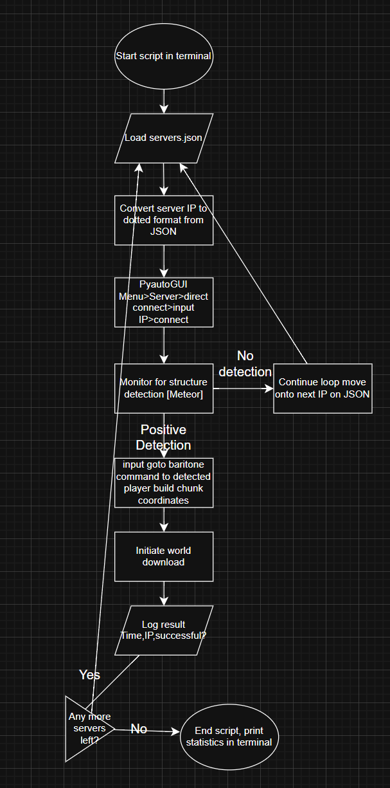
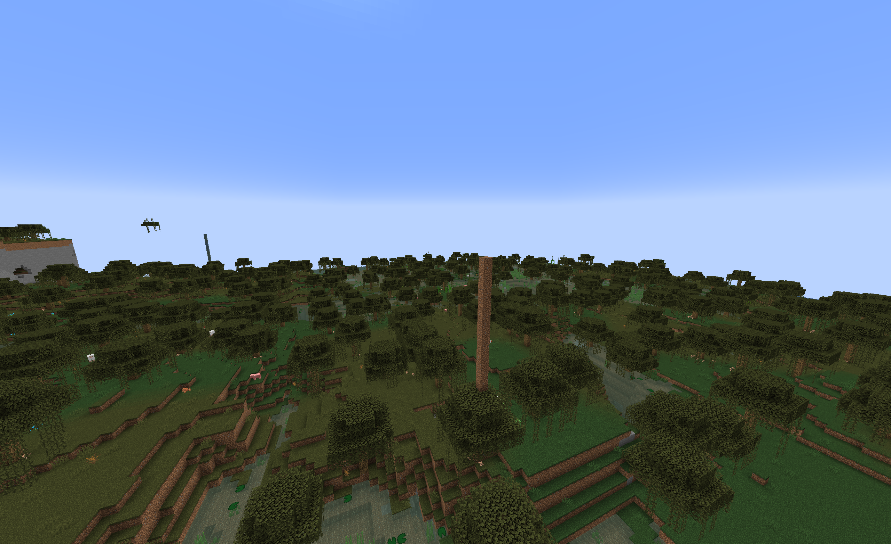
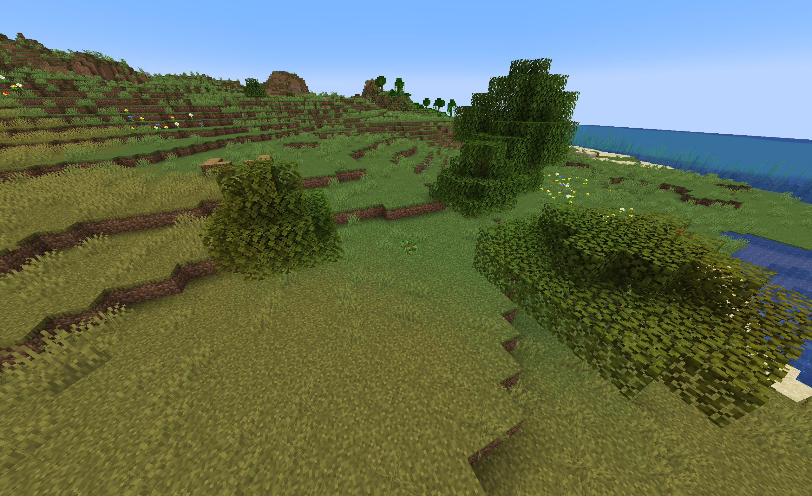
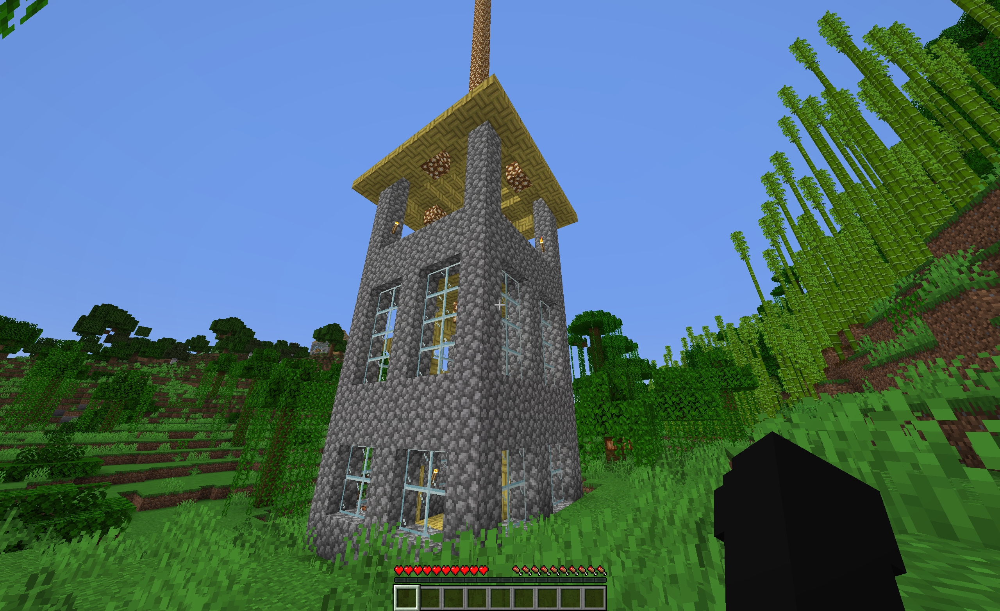
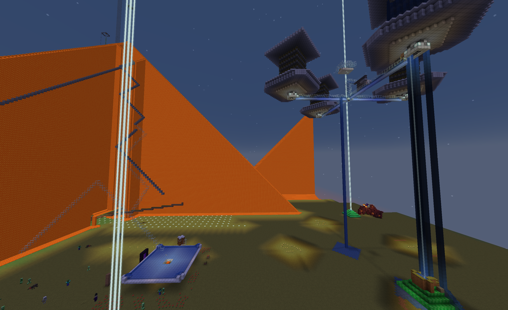
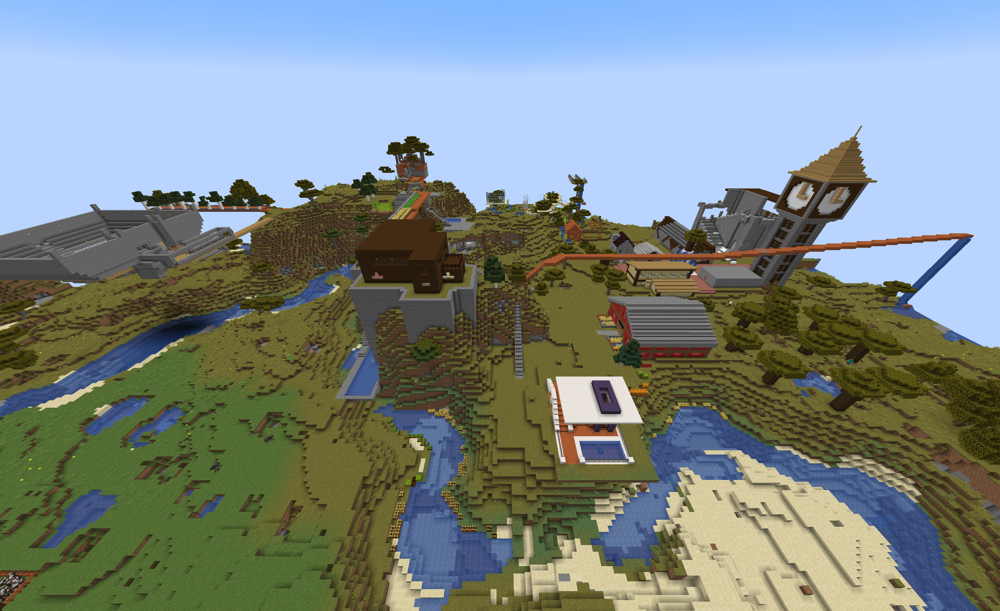
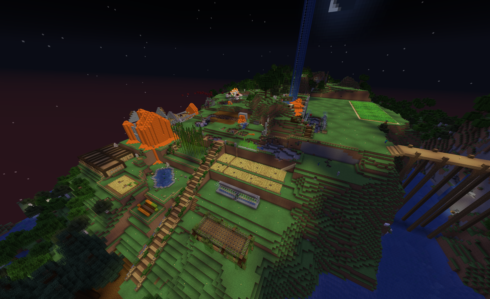
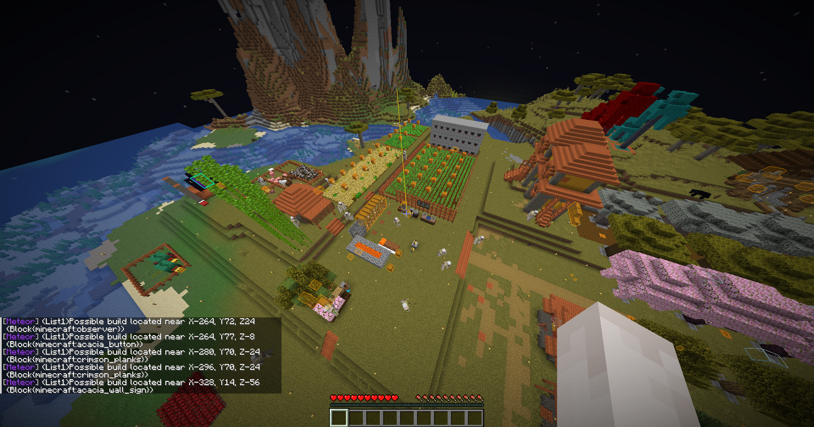
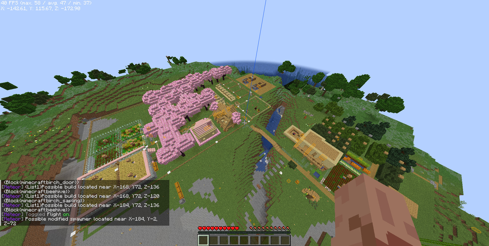

Minecraft Server Archiver

**COMPANION REPOSITORIES**

Report & Documentation

- Part-1: <https://github.com/SF2040/Project-Portfolio/blob/main/Minecraft-Server-Archiver-PT1.md>

- Part-2: <https://github.com/SF2040/Project-Portfolio/blob/main/Minecraft-Server-Archiver-ISO14721-PT2.md>

Builds & Scripts

- Server-Archiver Python script: <https://github.com/SF2040/minecraft-server-archive>

- ISO-14721 AIP: <https://github.com/SF2040/minecraft-archive-AIPUPLOAD>

Other:

- Live demo: <https://youtu.be/6s74uC5A6zg>

- ISO pub: [CCSDS 650.0-M-3](https://ccsds.org/Pubs/650x0m3.pdf)

# Overview
An automated system that discovers, joins, scans, and archives worlds from public vanilla Minecraft servers that contain player-built structures.  

## Technology Stack
- Language: Python 3.12
- Automation: PyAutoGUI (mouse/keyboard control)
- Minecraft Java Edition (1.21.4) Fabric
- Mods:
  - Meteor Client (structure detection via logs)
	  - https://anticope.pages.dev/addons/?
		    https://anticope.pages.dev/addons/?addon=etianl%2FTrouser-Streak (Basefinder Module)
	     https://www.meteoraddons.com/ (Meteor Addons)
	  - [WorldTools](https://www.curseforge.com/minecraft/mc-mods/worldtools) (World downloader)
	  - [ViaFabricPlus](https://modrinth.com/mod/viafabricplus) (cross-version compatibility, this archiver can download worlds on MOST versions but may lead to corruption)
	  - [Baritone](https://meteorclient.com/api/downloadBaritone)  
	  - [ImmediatelyFast](https://modrinth.com/mod/immediatelyfast) (Chunk loading performance for faster detections)
	  - Lithium (performance)
	  - Fabric-api
	  - Fabric-language-koltin
	  - Cloth-config
	  - Sodium (performance)
		Sodium Extra (performance)
- [Data Source](https://github.com/kgurchiek): Open port servers (https://api.cornbread2100.com/) 

# Tutorial
https://youtu.be/6s74uC5A6zg

# System Architecture / Workflow

## Initial runs
**False positives:**

A sapling cannot be generated naturally, hence why a player made build was triggered and the world download was initiated. This is uninteresting and not worth the download. We can update our block finder list to remove uninteresting 'Player placed' blocks.
**True positives:**

**Errors:**

Most of the interesting part of the build was not rendered, therefore it did not make its way to the download. However, in the logs we are still able to see the IP address of this server, so with a quick connect we are able to join and possibly attempt to archive the rest of the world.

Error 2
 
The world being cuttoff and void is not the error itself, this is enabled to save space. The error being presented is detected structures are not being fully rendered or saved.

**Notes:** 
- Many duplicate downloads
- Many uninteresting or not fully saved worlds (Small builds, half builds saved)
## Future Improvements
- Open any chests to load them in save file
- Optimise python script timing & baritone pathing settings.
- Automate API requests to input into `servers.json`

# Framework (ISO14721) Open Archival Information System
ISO 14721:2025 Space Data System Practices — Reference model for an open archival information system (OAIS)

FUNCTIONS

| OAIS function                 | Quote                                                                                                     | In current pipeline                                                            | Status                                                    |
| ----------------------------- | --------------------------------------------------------------------------------------------------------- | ------------------------------------------------------------------------------ | --------------------------------------------------------- |
| **Producer**                  | Source of submissions                                                                                     | Third-party server-list API (`servers.json`)                                   | Implemented (manual fetch)                                |
| **Ingest**                    | Provides functions to “accept Submission Information Packages (SIPs) from Producers”                      | Join server, Meteor detects builds, F12 triggers the WorldTools download       | Implemented                                               |
| **Ingest: Quality Assurance** | “validates (QA results) the successful transfer of the SIP”                                               | Script waits for `[WorldTools] Saved` in `latest.log`                          | Partial (confirms the save, not that the data is correct) |
| **Archival Storage**          | “storage, maintenance and retrieval of AIPs”                                                              | Worlds saved to `.minecraft\saves\`                                            | Partial (storage only)                                    |
| **Data Management**           | Maintains “Descriptive Information which identifies and documents Archive holdings”                       | `archival_log.txt` records IP, port, version, country, timestamps, and outcome | Partial (a log, not a database)                           |
| **Administration**            | “overall operation of the Archive system”                                                                 | Config constants, error handling, connection-failure recovery, disclaimer      | Partial                                                   |
| ***Preservation Planning***   | *“monitoring the environment of the OAIS”*                                                                | *Not implemented*                                                              |                                                           |
| ***Access***                  | *Helps Consumers with “determining the existence, description, location and availability of information”* | *Planned: automatic upload to GitHub repo (currently manual)*                  |                                                           |

# Conclusion
Digital preservation is important, especially human made content.
With the rapid growth of ai & technological obsolescence, it is more important than ever to preserve digital content by humans.
In this project, we go beyond preserving data on a simple hard-drive.
We use active monitoring, fixity checks, and data migration to ensure long-term usability.

## Skills Demonstrated
- Python and automation scripting with pyautogui
- Troubleshooting & optimisations
- API calling
- Design end-to-end workflow pipelines with system integrations:  python,java,json, API, mods, external tools
- Reverse engineer errors & bugs for optimisation

## DISCLAIMER
**NOT AN OFFICIAL MINECRAFT PRODUCT OR SERVICE. NOT APPROVED BY OR ASSOCIATED WITH MOJANG OR MICROSOFT**

This project is an independent, non-commercial tool developed solely for personal research, educational purposes, and data preservation.

Where authentication is used, the project requires a legitimate Minecraft account and does not support or promote account piracy or unauthorised access [1](https://www.minecraft.net/en-us/usage-guidelines#:~:text=Servers%20and%20hosting)

This project does not distribute copyrighted Microsoft/Mojang source code, game assets, or modified Minecraft client binaries. Any third-party modifications used with the project was obtained and used by the user in accordance with their applicable licences and the Minecraft EULA and Usage Guidelines [2](https://www.minecraft.net/en-us/eula#:~:text=what%20you%20can%20and%20can%E2%80%99t%20do%20with%20Minecraft%20software%20and%20content)

All automated interactions are restricted to publicly accessible servers with whitelisting disabled and valid account authentication (`"cracked": false`), utilizing a legitimate, paid-for Minecraft account in strict accordance with server access requirements. 
**The absence of an enabled whitelist shows the accessed server(s) are configured by the server operator to accept connections from players globally.**

**Ref:**
- 1 Minecraft End User License Agreement: [https://www.minecraft.net/en-us/eula](https://www.minecraft.net/en-us/eula)
- 2 Minecraft Usage Guidelines: [https://www.minecraft.net/en-us/usage-guidelines](https://www.minecraft.net/en-us/usage-guidelines)
- 3 Microsoft Services Agreement [https://www.microsoft.com/en-au/servicesagreement](https://www.microsoft.com/en-au/servicesagreement)
