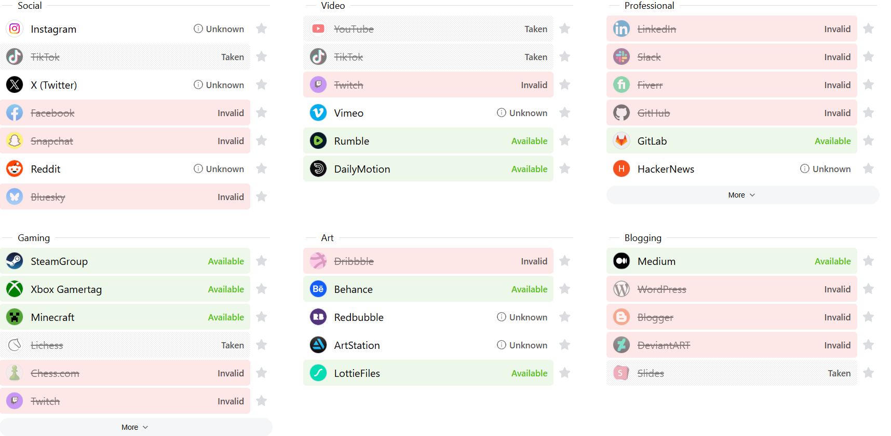
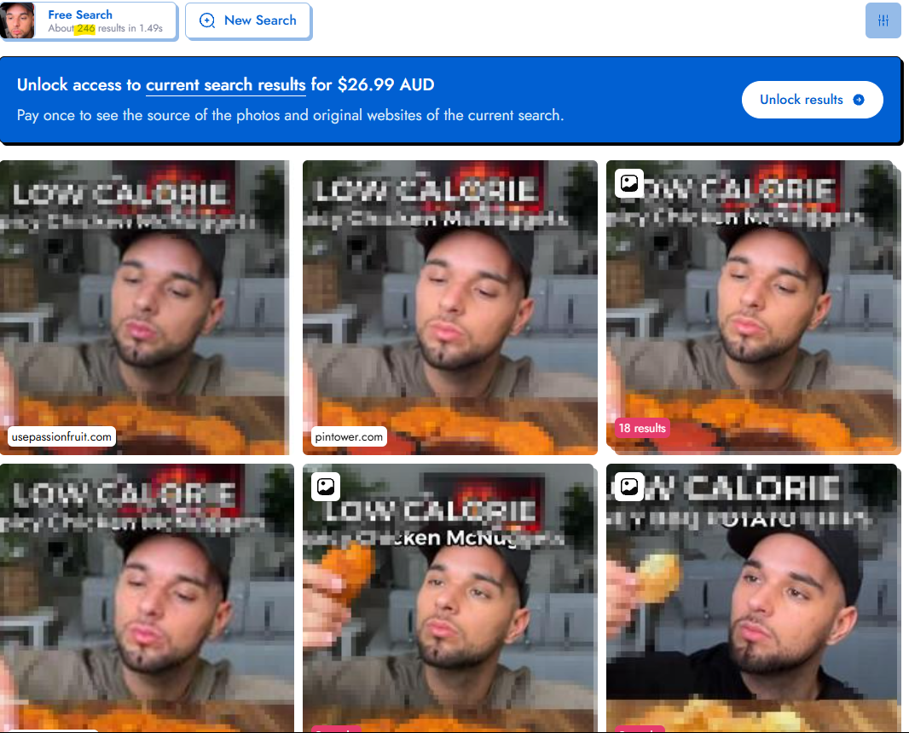
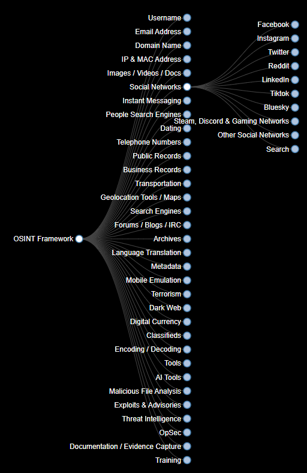
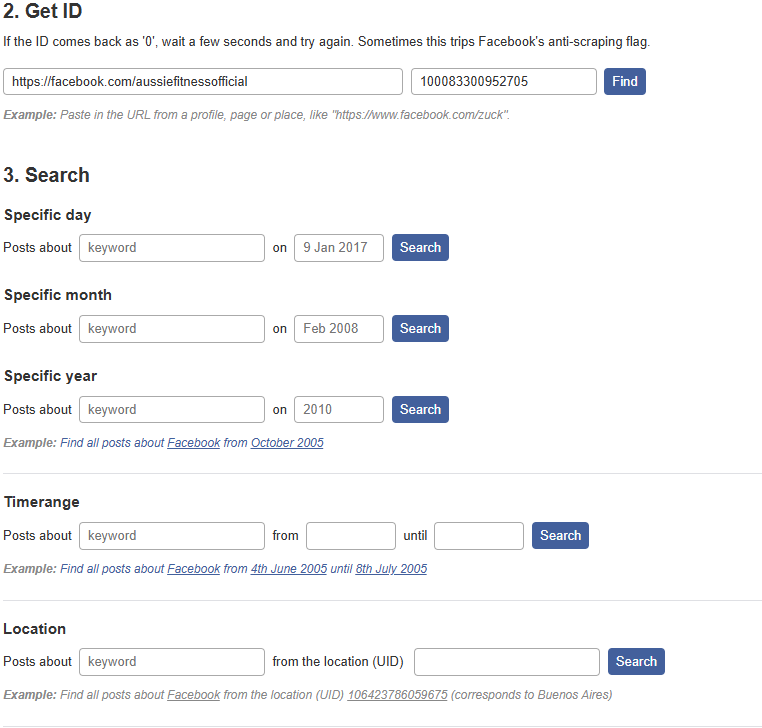
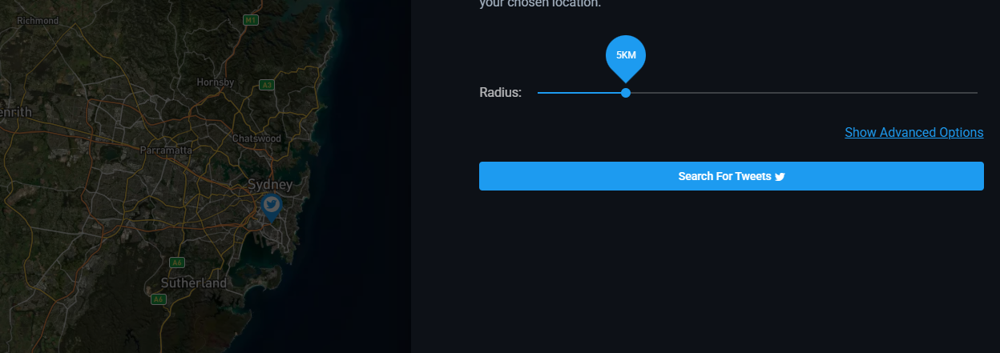
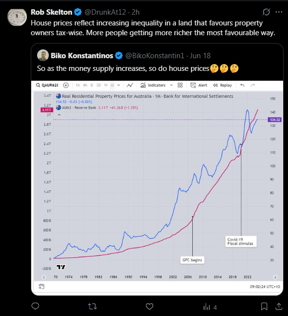

# What is OSINT?
**Open-Source Intelligence** is the process of collecting, analysing, and correlating information from publicly available sources. OSINT can be used in cybersecurity investigations to identify online identities, investigate digital footprints, discover relationships between accounts, and gather information relevant to an investigation.

https://osintframework.com/
## SOCMINT
**Social Media Intelligence** is a subset of OSINT focused specifically on information obtained from social media platforms. It involves analysing publicly available social media content, accounts, interactions, and associated metadata to build an understanding of a person, organisation, or online activity.
## Types of social media data
1. User Posted - Posts, images, videos, comments, and other content published by users.
2. Metadata - Information associated with content, such as timestamps, locations, and technical information.
3. Interactions - Likes, comments, follows, mentions, shares, and relationships between accounts.
# OSINT Framework

A tool we can use is https://instantusername.com/ to find any social media account that has the same username you have inputted. For my target, i will be using a semi-popular social media account that creates food content. _aussiefitness_

We can see that the name is taken on larger social media platforms, e.g youtube,tiktok & instagram. Since this is a food/fitness account, it wont be taken on gaming/art platforms. This website is a great way to find out quickly if somebody has been reusing a username on different platforms.
## Tools & Techniques
Another great website/tool we can use is https://pimeyes.com/en. It is a website for reverse face image search. We will be using _aussiefitness_'s face as an example.

We can see that there are 246 results since this user has a large following (3m followers on instagram) The website also shows what other platforms this face is being used.
If we were using an individual that doesnt have a large public following, there is a chance that the website can find private photos (e.g photo on a private facebook account)
# Deep Dive
Using https://osintframework.com/ we can do a deeper dive on OSINT based on specific needs

If we, for example were screening potential employees for a background check for a paper company before hiring, we would check social media. If we were screening potential employees for a high risk company like a bank or a government position, we would do a larger check e.g for terrorism, Dark Web, Metadata, Archives.
## Facebook
We will be using _aussiefitness_ for a facebook search using https://whopostedwhat.com/.

We're able to look for a specific keyword & specific dates.
## Instagram
Next we will try Instagram. The OSINT framework recommends a tool called "OSINTAGRAM" https://github.com/Datalux/Osintgram we will be installing this on our VM.
-`git clone https://github.com/Datalux/Osintgram.git`
-`cd Osintgram`
-`python3 -m venv venv`
-`source venv/bin/activate`
-`pip install -r requirements.txt`
-Open the `credentials.ini` file in the `config` folder and write your Instagram account username and password in the corresponding fields. it is recommended to use a burner/alt account.
-Use echo to input your Instagram login credentials
-Launch tool `python3 main.py <target_username>` 
Make sure the virtual environment is running python 3.10. Use a vpn before running the script
Unfortunately i have ran into a problem with Instagram's checkpoint loop. I will need to try again in 24h
## Twitter/X.com
We can use https://birdhunt.huntintel.io/ to find twitter posted with geolocation.
If we choose Sydney with a 5km search radius...

We will be able to see posts that are relevant to Australia

The interesting thing about this post is that there are no plaintext keywords that mention "Australia" the keywords are inside the image being posted.
We will be automating OSINT tools&searches using python in a later project

# Conclusion
Anything you post online, isn't yours anymore.

This project demonstrated how OSINT and SOCMINT techniques can be used to investigate publicly available information across multiple social media platforms. We used username enumeration, reverse image searching, keyword and date-based searches, and geolocation searches to identify and correlate information about an online target.
- OSINT and SOCMINT investigation
- Social media account enumeration
- Username and identity investigation
- Reverse image searching
- Social media data analysis
- Geolocation investigation/Metadata analysis/Digital footprint analysis
- OSINT tool selection and use
- Kali Linux and Python environment management
