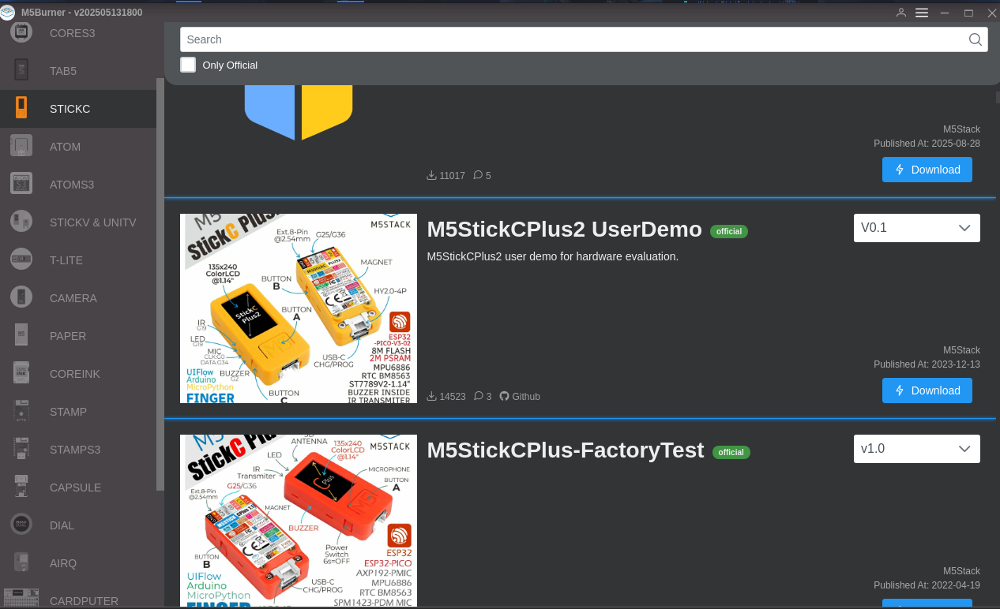
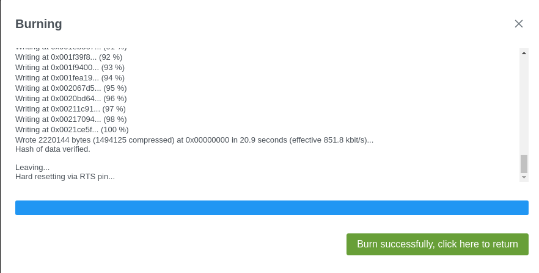
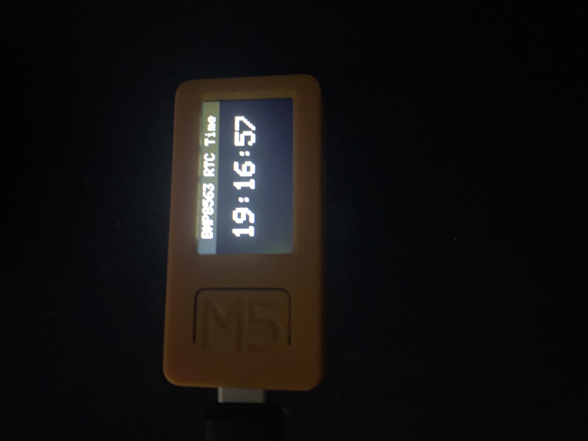
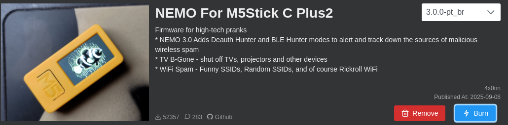
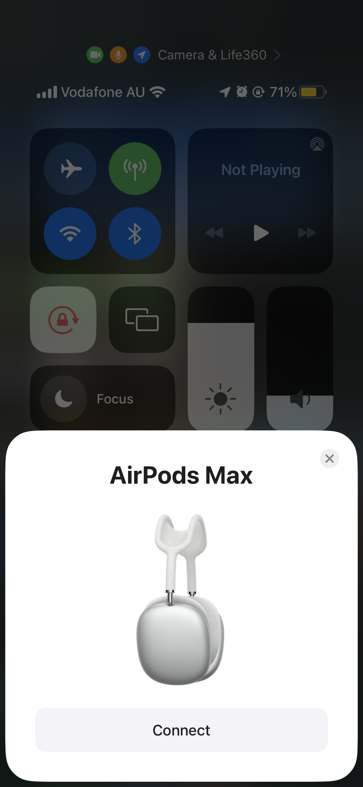
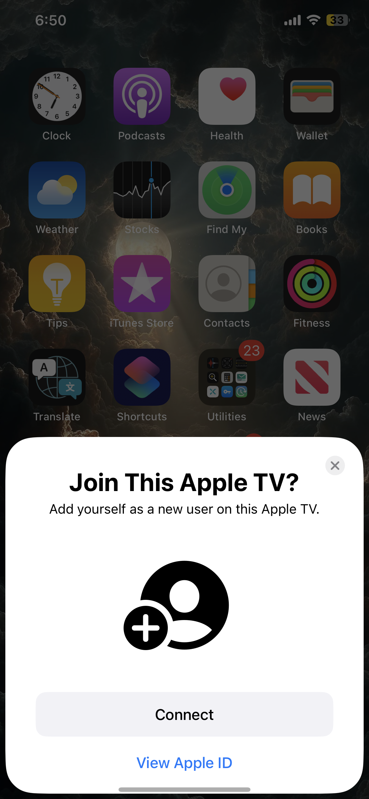
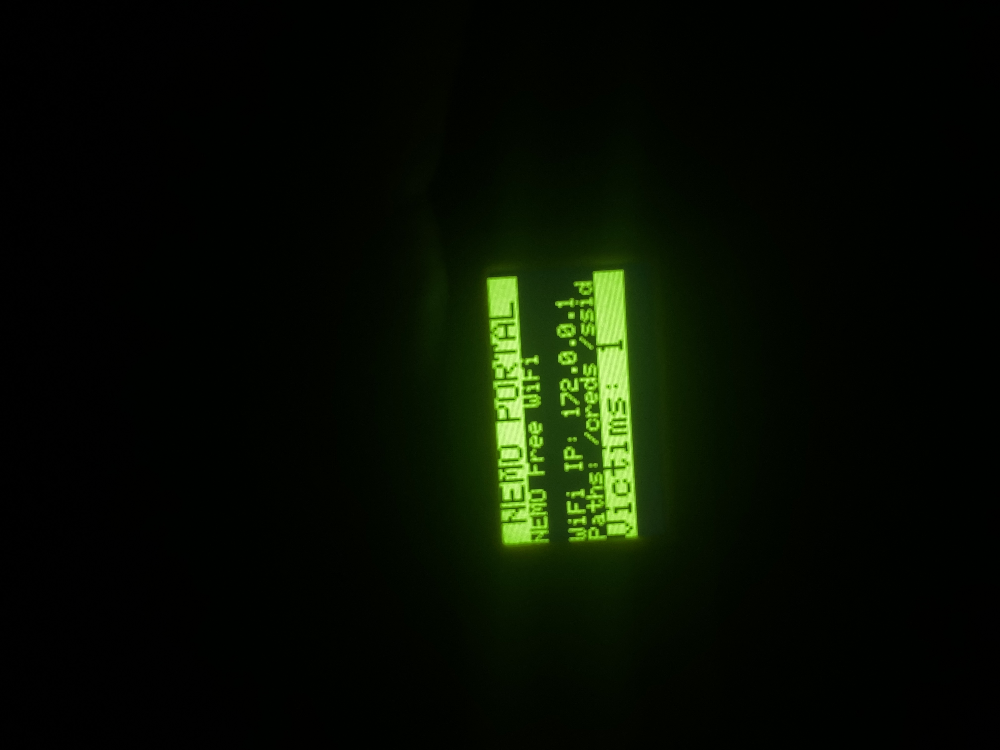
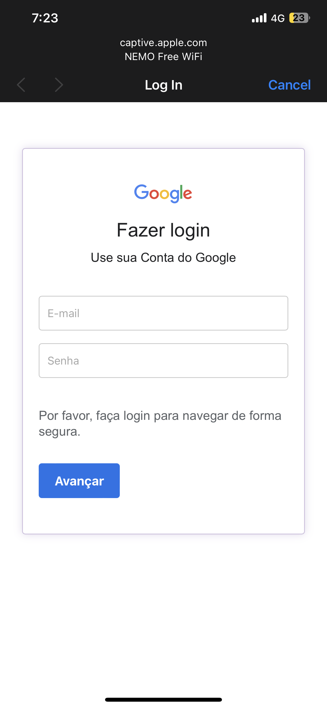
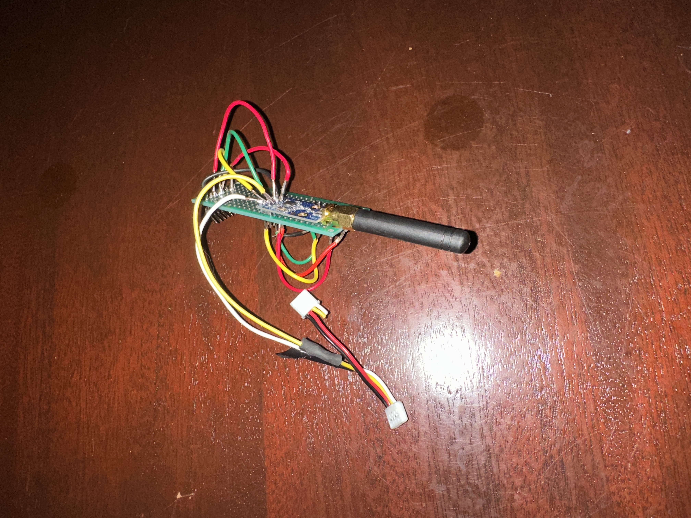
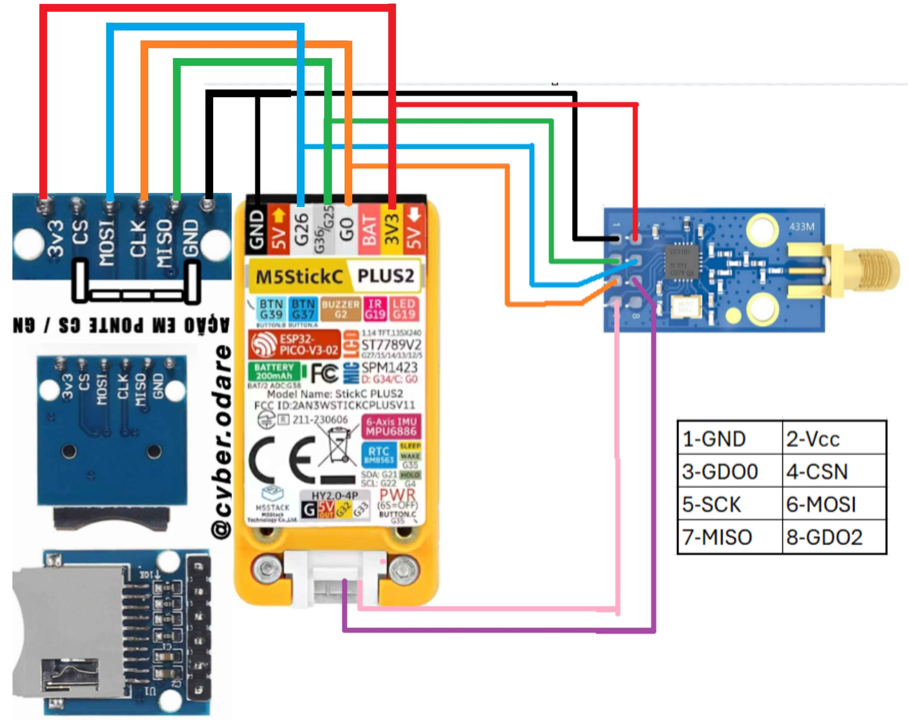

15/09/25

**SKILLS DEMONSTRATED**

**Physical**
- Basic soldering
- Hardware assembly
- Reading pinout diagrams and schematics
- Connecting external modules
- GPIO and peripheral connections
- Hardware troubleshooting
- Soldering proficiency:  https://github.com/SF2040/Project-Portfolio/blob/main/screenshots/m5-10.jpg
  

**Digital**
- ESP32 development
- Firmware flashing and configuration
- Embedded systems
- Wi-Fi and Bluetooth concepts
- RF technology
- SD card/SPI integration
- Firmware troubleshooting
- Open-source project research

This project explores the capabilities of the **M5Stack Cardputer/ESP32 development platform** and its use with different custom firmware and hardware modules.
The device is based on an ESP32.
Building on our previous experience with ESP32 hardware through the [NerdMiner](https://github.com/SF2040/Project-Portfolio/blob/main/nerdminer.md) project, we used this project to develop practical skills in firmware flashing, embedded hardware configuration, wireless technologies and hardware modification.
The M5Stick is a pre-configured ESP32 boards with fundamental attachments (*Microphone, speaker, infared emitted, display*.) Which we can then add-on with more attachments that fit our use case.

# Getting Started
We have now downloaded [M5Burner](https://docs.m5stack.com/en/uiflow/m5burner/intro) to flash our board.
We will download the userdemo to start and test functionality.

The flash was successful, this is similar to the [Nerdminer](https://github.com/SF2040/Project-Portfolio/blob/main/nerdminer.md) project flashing as these are both ESP32 boards. 

# Demonstration 
## Nemo
Now that we know it works we will be downloading a custom firmware called Nemo
We will demonstrate some of the utilities built into the Nemo firmware.
### Bluetooth

We receive multiple bluetooth pair requests, often crashing the device.

### Wi-Fi
We can use the Nemo portal to launch a phishing wifi network.

Nemo also provides functionality for creating a **rogue Wi-Fi access point and captive portal**. This demonstrates how a fake network can be presented to users and how credentials could potentially be collected.
The credentials would be saved to an SD card if we had one mounted.
## Bruce
[GitHub - pr3y/Bruce: Predatory ESP32 Firmware](https://github.com/pr3y/Bruce/?tab=readme-ov-file#fm)
The Bruce firmware UI is much more clean with many more features than Nemo, It can do the same things that Nemo can but with other features. Its able to create a fake wifi portal phishing screen, De-auths, Bluetooth spam etc. 

Adding attachments to the device will allow us to use the RF, RFID, IR, FM, NRF24 scripts.

## CatHack
[GitHub - Stachugit/CatHack](https://github.com/Stachugit/CatHack)
We also explored [CatHack](https://github.com/Stachugit/CatHack), another ESP32-based firmware/project designed to provide additional hardware and wireless functionality.

This provided further experience with third-party ESP32 firmware and the configuration required to make external modules work with the development board.
## Attachments

We have followed the pinout diagram for our esp32 board and added a micro SD card reader and a CC1101 module.
We have tried to test the CC1101 module, it shows up as being connected but cannot receive any radio waves. The CC1101 can listen to sub-gigahertz frequencies (300-928 MHz). Usually in a household or commercial buildings, there would be plenty of noise in this frequency range and the transceiver could pick it up, however this doesn't seem to work at the moment. We will have to take a closer look at our solders to check if there are any pins overlapping with the solder.

# Conclusion
Consumer available IOT devices can easily be configured to conduct malicious attacks. Even with little to no technical skills.
An even easier version for this is the [Flipper Zero](https://flipper.net/), it is also based on an ESP32 with added attachments and pre-configured firmware

Stay Safe!
