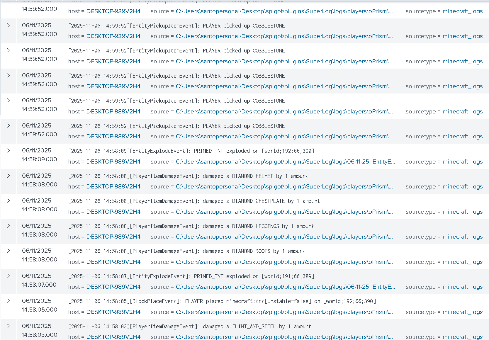
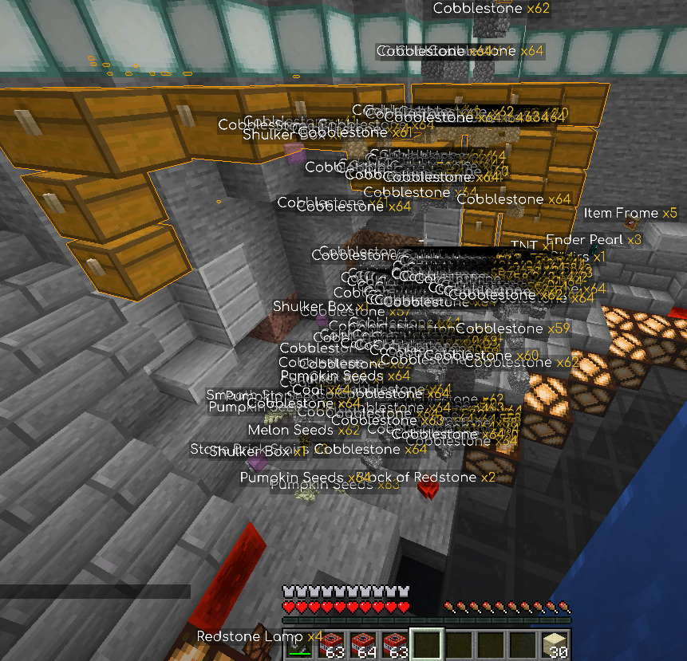
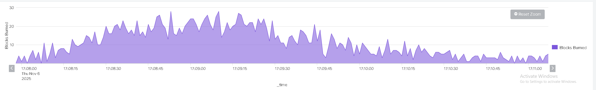
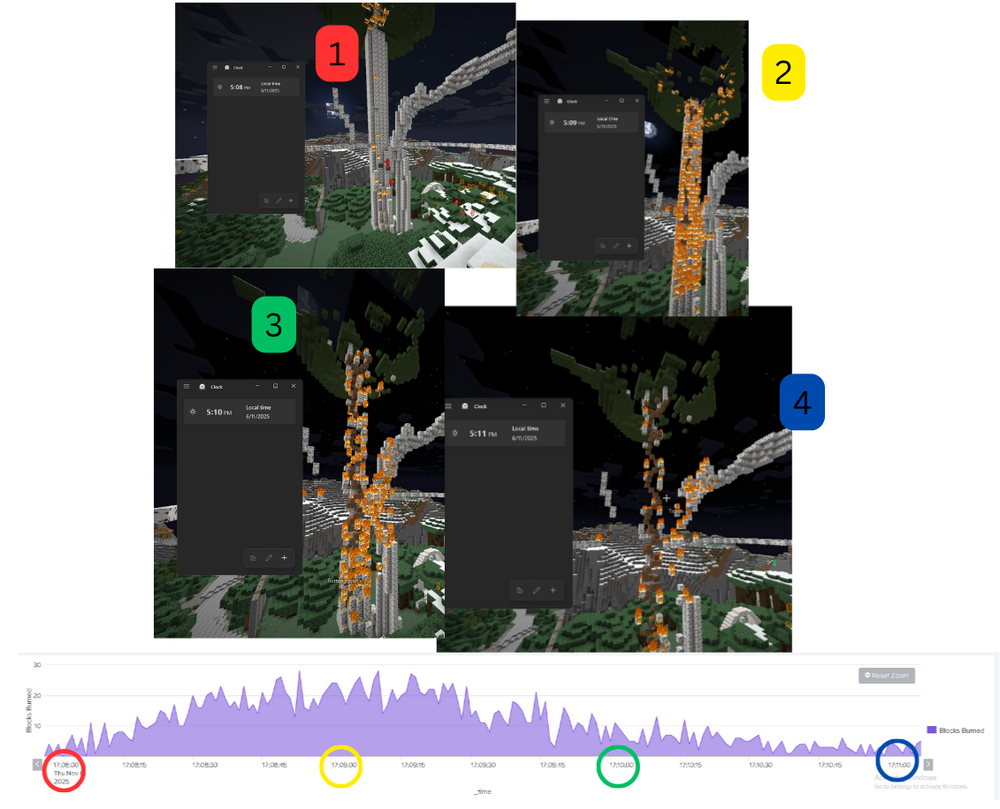

# Incident 1 - TNT
**Summary**
This chain of events indicates somebody is griefing, we can establish a timeline of events to make a guess as to what has happened, if we were unable to access the actual server.
Obviously `PLAYER placed minecraft:tnt[unstable=false] on [world;192;66;390]` & `PRIMED_TNT exploded on [world;191;66;389]` Gives away what happened, but we can also see `[PlayerItemDamageEvent]: damaged a DIAMOND_CHESTPLATE by 1 amount` & `[EntityPickupItemEvent]: PLAYER picked up COBBLESTONE`X24 If we for some reason have not added the logging of `TNT` events, we can try make a story with the armour being damaged, and the mass amounts of the same item being picked up in such a short amount of time (All in the same second 14:59:52) We can guess that: a player has had damage inflicted on themselves via an explosion while trying to blow up chests filled with cobblestone.

**Timeline**

| Flint & Steel use `PlayerItemDamageEvent` `damaged a FLINT_AND_STEEL` | Player Ignites TNT `PlayerInteractEvent` `Player PRIMED_TNT` | Chest Exploded `BlockExplodeEvent` `CHEST exploded` | Armor damage from explosion `PlayerItemDamageEvent` `damaged a DIAMOND_*` | Player picks up blocks from exploded chest `EntityPickupEvent` `PLAYER picked up COBBLESTONE` |
| --------------------------------------------------------------------------- | ------------------------------------------------------------------ | --------------------------------------------------------- | ------------------------------------------------------------------------------- | --------------------------------------------------------------------------------------------------- |
| 14:59:52                                                                    | 14:59:52                                                           | 14:59:52                                                  | 14:59:52                                                                        | 14:59:52                                                                                            |

**Framework**

| Date     | Incident                                   | MITRE tactic                                                         | MITRE technique                                                    |
| -------- | ------------------------------------------ | -------------------------------------------------------------------- | ------------------------------------------------------------------ |
| 14:59:52 | Explosion of chest `EntityExplodeEvent` | Impact [TA0040](https://attack.mitre.org/tactics/TA0040)          | Data Destruction[T1485](https://attack.mitre.org/techniques/T1485) |
| 15:02:36 | Player quit `PlayerQuitEvent`           | Defence Evasion [TA0005](https://attack.mitre.org/tactics/TA0005) | Exfiltration                                                       |

**Suggested actions**: Automate splunk to use remote console protocol to ban players when certain events are triggered
`sourcetype=minecraft_logs "EntityExplodeEvent"`
`| timechart span=1s count as "PRIMED_TNT exploded"`
`| where 'PRIMED_TNT exploded' > 5`
If this query ever returns an event, the player would be automatically banned.

**Conclusion**:

The chests were filled with cobblestone blocks and other miscellaneous. The offender was close to the TNT and picked up the cobblestone once its chest was exploded.
# Incident 2 Fire
Summary: The dashboard of fire spreading was increasing slowly, then started to drop.
`sourcetype=minecraft_logs "BlockBurnEvent"`
`| timechart span=1s count as "Blocks Burned"`

My thesis is that a large flammable build has gone up in flames and been burnt completely.

**Timeline**

| **Picture** | 1          | 2                    | 3            | 4                  |
| ----------- | ---------- | -------------------- | ------------ | ------------------ |
|             | Fire start | Fire spread & peaked | Fire slowing | Fire near complete |
| **Time**    | 17:08:00   | 17:09:00             | 17:010:00    | 17:11:00           |

**Framework**

| Time                     | Incident                                    | MITRE tactic                                               | MITRE technique                                                    |
| ------------------------ | ------------------------------------------- | ---------------------------------------------------------- | ------------------------------------------------------------------ |
| 17:07:58              | `PlayerInteractEvent` Used Flint & Steel | Execution[TA0002](https://attack.mitre.org/tactics/TA0002) | N/A                                                                |
| 17:08:00 17:11:00  | `BlockBurnEvent`                            | Impact[TA0040](https://attack.mitre.org/tactics/TA0040)    | Data Destruction[T1485](https://attack.mitre.org/techniques/T1485) |

**Suggested Actions**: Automate splunk to use remote console protocol to ban players when certain events are triggered

**Conclusion**:

# Skills Demonstrated
- **Setting up SplunkMC**
- **Installing & configuring minecraft plugins and files.**
- **Gather organic data to test for an in depth report**
- **Have a general understanding on how minecraft sends logs to splunk, and how they correlate.**
- **Splunk data visualisation & analysis**
- **Showcase framework implementation & incident reporting.**

Next steps: 
Automate bans/moderation using RCP with splunk events. 
Create honeypot server. 