[GitHub - sidward35/SplunkMC: Use Splunk to monitor your Minecraft activity](https://github.com/sidward35/SplunkMC)

# Setup
Once splunk is installed,
   `Settings > Forwarding and Receiving > Configure receiving > New Receiving Port`, add a listener on port `9997`

## Configure MC Spigot & open local server
1. Spigot. Follow [Installation | SpigotMC - High Performance Minecraft Community](https://www.spigotmc.org/wiki/spigot-installation/) to download a spigot file.
2. Create a new folder, put the buildtools.jar file inside of it. Compile it. 
   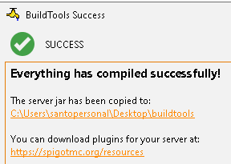
3. CD to where the buildtools.jar is located, and run `java -jar BuildTools.jar --rev 1.16.5` This will generate a spigot jar file for minecraft version 1.16.5

4. Move spigot.jar to a new folder.
   Create a new text document inside the new folder, name it `start.bat` and insert
`@echo off`  
`java -Xms2G -Xmx4G -XX:+UseG1GC -jar spigot.jar nogui`  
`pause`

5. Once ran `start.bat` once, open eula.txt and change `eula=false` to `eula=true`. Run the bat again
### Test server
`ipconfig` on server machine > input IP into minecraft direct connect.

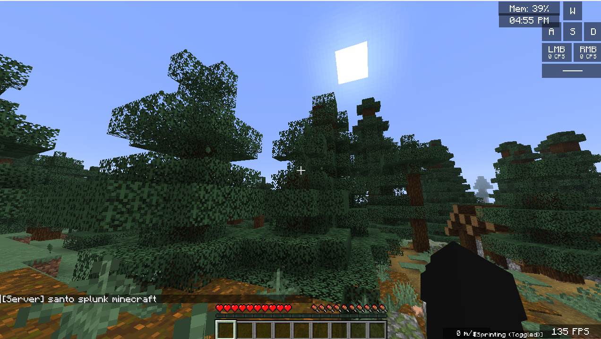
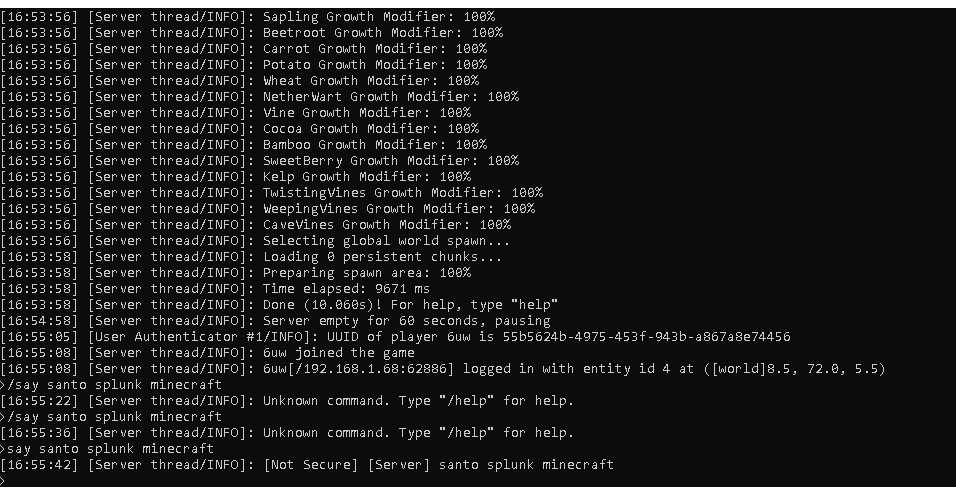
Our local server is working. We can connect and run administrative commands via the command prompt.

## SuperPlug Plugin
1. Download [SuperLog [Async][1.7-1.16] | SpigotMC - High Performance Minecraft Community](https://www.spigotmc.org/resources/superlog-async-1-7-1-16.65399/)
2. Put into plugins folder
3. Restart the server using `start.bat`
   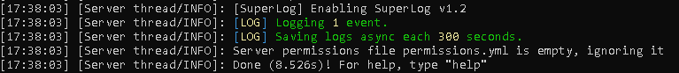
4. There should now be a superlog directory `$server/plugins/SuperLog/` locate the `config.yml` file, and paste the contents from here [raw.githubusercontent.com/sidward35/SplunkMC/master/plugin/src/main/resources/config.yml](https://raw.githubusercontent.com/sidward35/SplunkMC/master/plugin/src/main/resources/config.yml) into it 
5. Restart the server.

## Splunk Universal Forwarder
https://www.splunk.com/en_us/download/universal-forwarder.html
https://docs.splunk.com/Documentation/Forwarder/latest/Forwarder/HowtoforwarddatatoSplunkEnterprise

1. Install the splunk fowarder
2. `cd "C:\Program Files\SplunkUniversalForwarder\bin"`
3. `.\splunk.exe start`
4. `./splunk add forward-server host:9997`  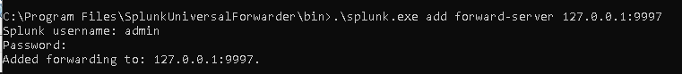
5. `./splunk add monitor $server/plugins/SuperLog/logs/ -sourcetype minecraft_log`s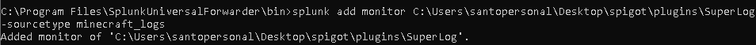

**We are now getting splunk logs from our minecraft server!**
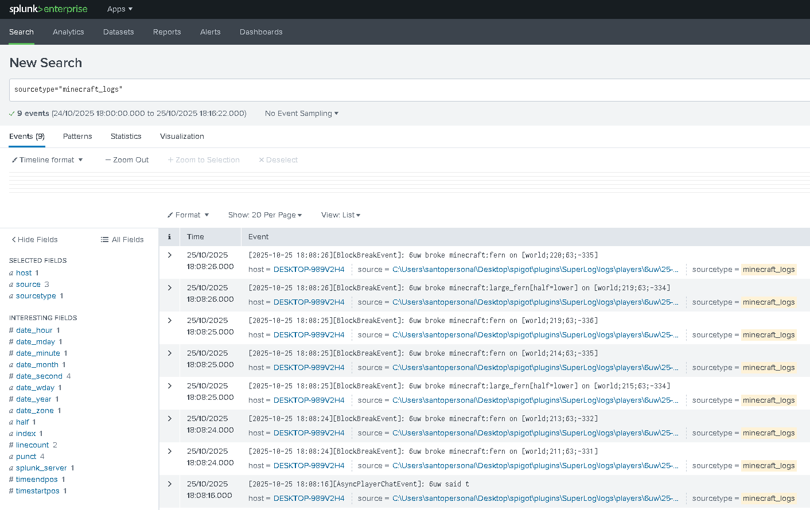

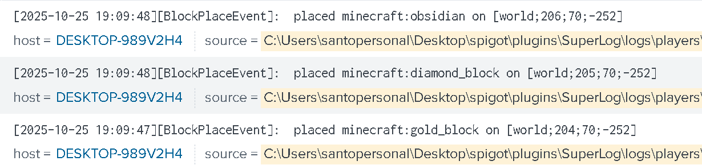

## Configuring events
In the `config.yml` folder we recently edited, it only has 3 events to be logged,
`AsyncPlayerChatEvent, BlockPlaceEvent, BlockBreakEvent`
That's why all we see in our splunk is block place and breaks, nothing else.
We can go to [SuperLog](https://superlog.andross.fr/#doc) and see all the other events we can log, and add them to the `config.yml` file.
In a real scenario, an administrator would use splunk to detect rule breakers on their server.

In this example, we will be administrating a hypothetical Vanilla Survival server, the rules generally are no utility mods/clients, no XRAY and no greifing.
We will need to manually add events & the correct arguments to capture & log before we actually do a quick playthrough to generate some events.
[Event (Spigot-API 1.21.10-R0.1-SNAPSHOT API)](https://hub.spigotmc.org/javadocs/spigot/org/bukkit/event/Event.html)
1. PlayerMoveEvent (Movement)
2. InventoryOpenEvent (ESP)
3. EntityExplodeEvent, PlayerBucketFillEvent (Grief)
4. EntityVelocityEvent (Anti Knockback)
5. BlockPlaceEvent, BlockBreakEvent (Xray)
6. PlayerChangedWorldEvent, EntityDeathEvent,PlayerItemConsumeEvent, PlayerAdvancementDoneEvent, PlayerKickEvent (Additional Monitoring)

# Gathering Real-World Data
Now that we have my configuration setup, we need a world to download and play on. Using a utility mod & playing on a fresh world wont give us enough data. 
Our scenario, is moderating an already established server.

See [[++PT1 Minecraft Server Archiver With Python]]

We've installed [WorldTools - Minecraft Mod](https://modrinth.com/mod/worldtools?version=1.21.4&loader=fabric) to download our worlds. They get saved directly to our single player world, then can be extracted and used on the spigot server.

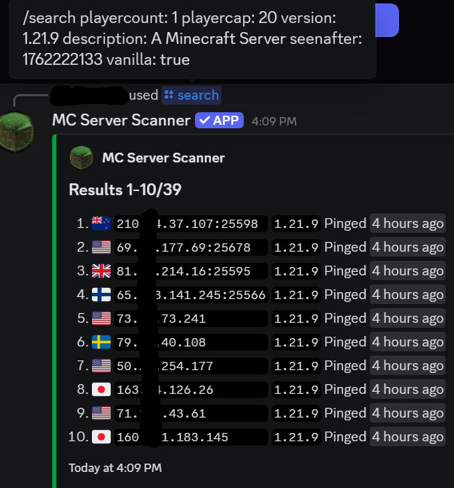
We use a simple search query to find a small multiplayer server that is active and has been lived on for a while. The service I am using is just a discord hook of [Shodan Search Engine](https://www.shodan.io/) 
Narrowing our search for 1.16.5, we have 3 servers...
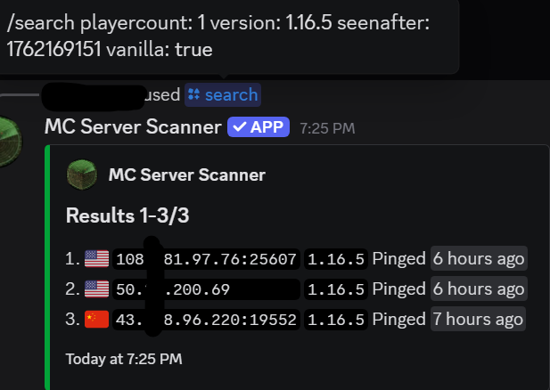
## DISCLAIMER
This download was performed on a *public, non-whitelisted Minecraft server*, meaning the server owner has chosen to allow unrestricted player access without authentication or invitation.
Under the Minecraft EULA, players are legally allowed to *receive and render world data (chunks) sent to their client during normal gameplay*.
I am *not modifying, redistributing, or selling Mojang’s proprietary game content*. The only data being saved is the same world information already transmitted to my game client during regular play.
This use is *non-commercial, educational*, and does not violate the EULA’s restrictions on monetization, reverse-engineering, or commercial exploitation.
https://account.mojang.com/documents/minecraft_eula
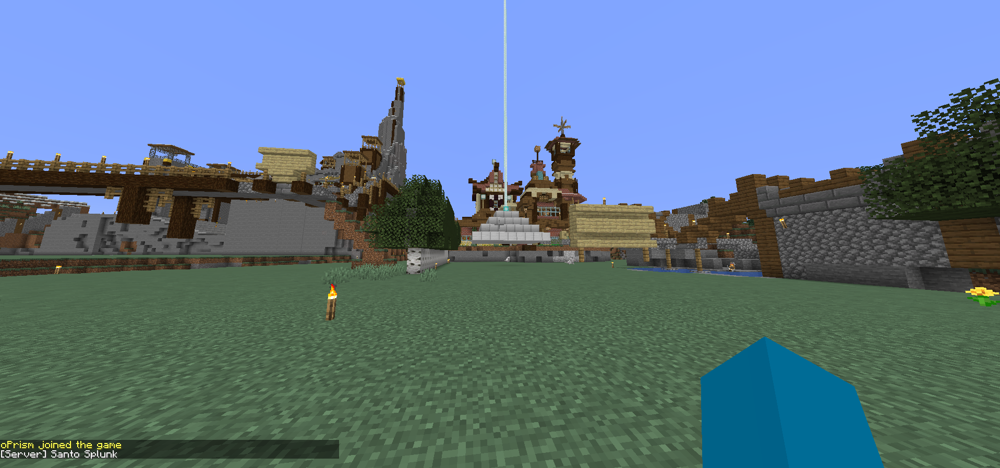
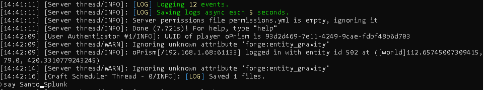
We've got our server to work with a real player made survival world on 1.16.5. During the download I had to manually open every chest on the world to save its data.
## Finalize
We need to finalize our `config.yml`
We can add extra arguments & conditions to the event.
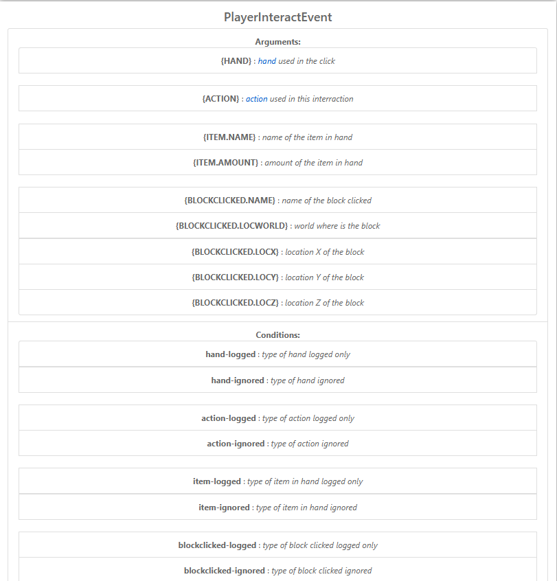
We add our own argument and edit the example config to look for flint & steel usage.
**EXAMPLE CONFIG**
`PlayerInteractEvent:`
	  `enabled: true`
	  `message: 'right clicked {BLOCKCLICKED.NAME} at [{BLOCKCLICKED.LOCWORLD};{BLOCKCLICKED.LOCX};{BLOCKCLICKED.LOCY};{BLOCKCLICKED.LOCZ}]'`
	  `hand-logged:`
	  - `'HAND'`
	  `action-logged:`
	  - `'RIGHT_CLICK_BLOCK'`
	  `blockclicked-logged:`
	  - `'STONE_BUTTON'`
	  - `'OAK_BUTTON'`
**EDITED CONFIG**
`PlayerInteractEvent:`
	`enabled: true`
	`message: '{PLAYER} used Flint & Steel on {BLOCKCLICKED.NAME} at [{BLOCKCLICKED.LOCWORLD};{BLOCKCLICKED.LOCX};{BLOCKCLICKED.LOCY};{BLOCKCLICKED.LOCZ}]'`
	`action-logged:`
	- `'RIGHT_CLICK_BLOCK'`
	`item-logged:`
	- `'FLINT_AND_STEEL'`
	`hand-logged:`
	- `'HAND'`
We edit our config to explicitly detect Flint & steel being used, the example config given was simply create a log if there was a right click on a stone/oak button.
We also configure BlockPlaceEvent to detect air place.
`BlockPlaceEvent:`
    `enabled: true`
    `message: 'Air Place with {ITEMINHAND.NAME} on [{LOCWORLD};{LOCX};{LOCY};{LOCZ}]'`
    `placedAgainst:`
    `- 'AIR'`

### CONTROL MAPPING
[The NIST Cybersecurity Framework (CSF) 2.0](https://nvlpubs.nist.gov/nistpubs/CSWP/NIST.CSWP.29.pdf)
- Identify (ID.RA): Organisations must identify their likelihood of encountering a threat and configure controls/logging accordingly. In this case, a survival minecraft server will configure logging to detect survival based cheating/griefing, tnt abuse, flying etc.
  In another example, if the organisation was a minigame server, they would need to configure controls & logging for combat based cheats.
- Protect(PR.IP-1): Configure logging based on the likelihood. Ban offenders. Update logging configurations based on new trends/cheats.
- Detect(DE.CM-1 / DE.CM-7): Organisations monitor appropriate events and tune detection systems to detect malicious activity.

# Inspecting & Identifying data
Now that everything is setup, we can begin a quick playthrough/demonstration with utility mods.
*I am running my own local server and give myself permission to use a modified client on this server.*

We have personally configured the splunk logs to look for Air Place (not achievable in regular versions of the game) 
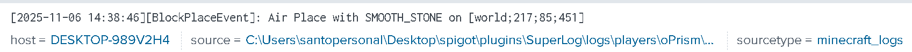
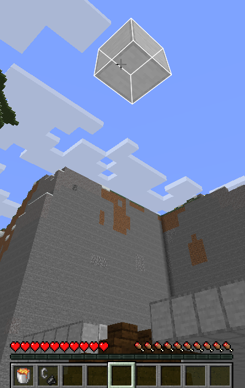
Even without changing any configurations, we are still able to detect abnormal activity
AutoMountain
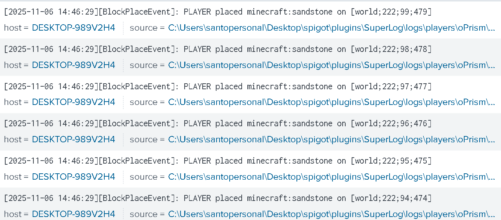
We can see some irregular block placement, somehow the player is placing blocks perfectly diaganal, (Looking at coordinates, the Y & Z axis both go up by one)
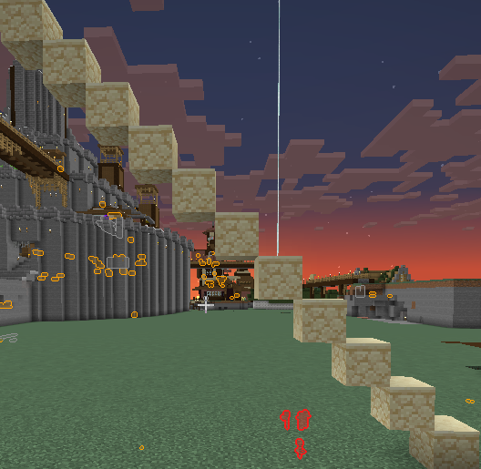
A vanilla player would give these events
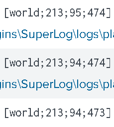
Notice the Y axis stays the same twice, that is because the first two blocks are needed so that to go up 1 Y axis there would need to be a block below it to place on.
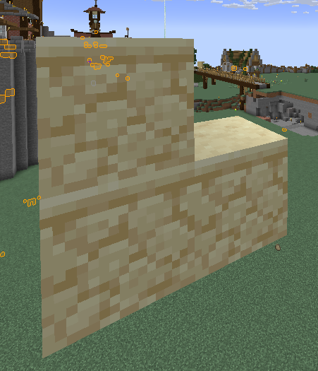
## Splunk Dashboard Visulisation.
The biggest concern on a vanilla world is destruction.
Ive created 2 dashboards to visualise fire spreading & tnt explosions
One of the panels on the dashboard we created can be used as a live monitoring widget to show recent explosions.
It updates on a 1minute timeframe. In an ideal scenario, this would always not display data, but if a griefer attempts to ignite/place alot of tnt at once, The TNT PLACE would be an early warning indicator, the TNT EXPLODE would be confirmation that it was not a false positive.
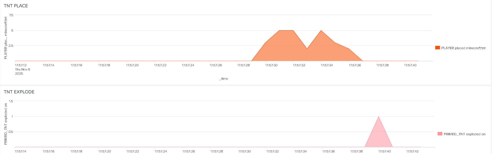
TNT PLACE:
`sourcetype=minecraft_logs "BlockPlaceEvent"`
`| timechart span=1s count as "PLAYER placed minecraft:tnt"`
TNT EXPLODE
`sourcetype=minecraft_logs "EntityExplodeEvent"`
`| timechart span=1s count as "PRIMED_TNT exploded on"`

The second dashboard created was to monitor fire spreading
Fires can be natrually generated and are not a threat, having a visulisation of blocks destroyed by fire overtime can help bring attention to a potential fire spread when watching the graph slowly increase.
Using a simple query with a graph chart would help show events.
`sourcetype=minecraft_logs "BlockBurnEvent"`
`| timechart span=1m count as "Blocks Burned"`

-------
 **So far I have demonstrated**
 - **Setting up SplunkMC** (Connecting 3rd party applications to a working pipeline)
 - **Installing & configuring Minecraft plugins and files.** (File systems, Java)
 - **Framework Implementation**
 - **Visualise & correlate Minecraft events into Splunk incident scenarios**

----------

We can now move onto our report on our incidents

# [[+Minecraft & Splunk REPORT]] 
