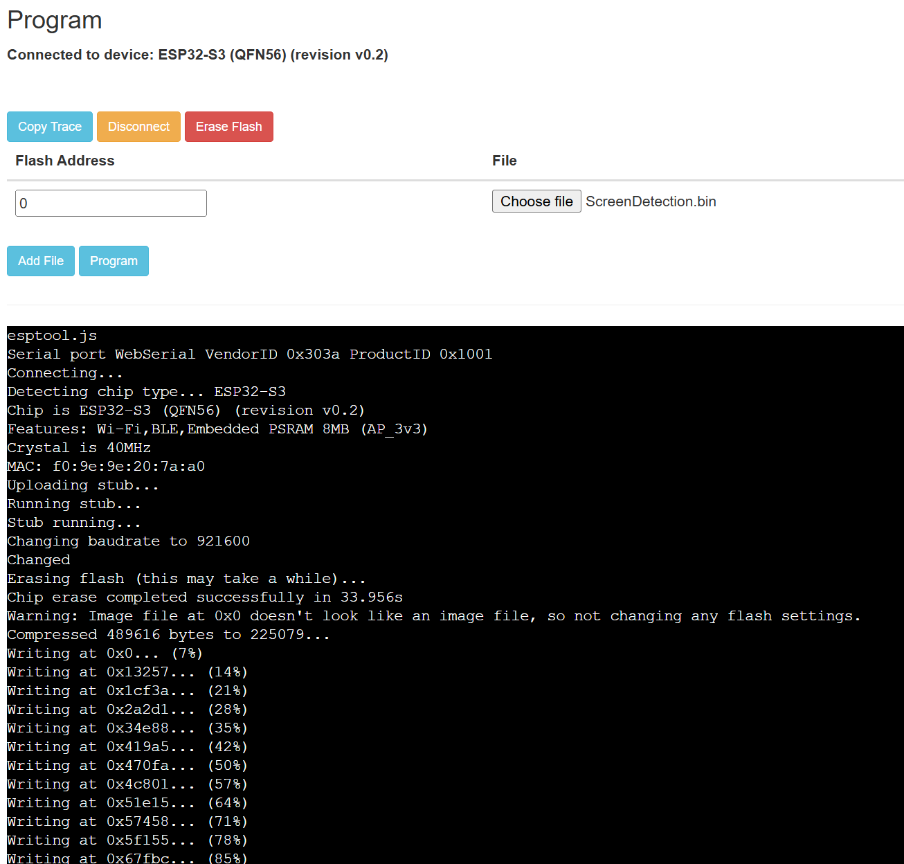
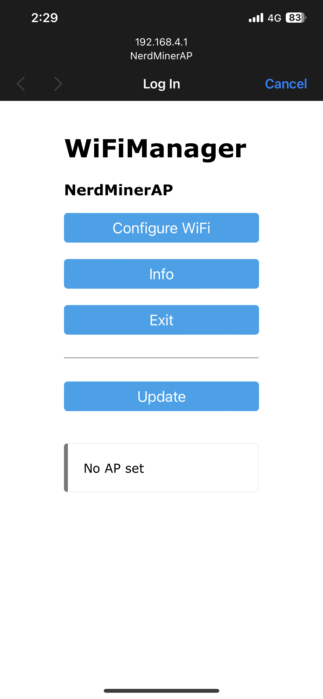
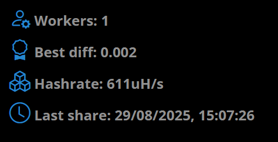

A nerd miner is a very small bitcoin miner. It has other names such as a "lottery Miner"
The device itself will not generate any income, but there is a small chance (**1 in 15,160,512,820,512,822** with 78KH/s) every 10 minutes, that you will be able to mine an entire block (As of 2025, 3.125 btc)
Realistically, the amount of time for hitting a block with a single 78KH/s miner is **288,442,024,743 years** But it has been achieved before: [Solo Bitcoin Miner Wins $371K Reward After Mining Block 910,440](https://cointelegraph.com/news/solo-bitcoin-miner-371k-block-reward-august-2025)

We will be using the nerdminers github page to create our lottery miner: https://github.com/BitMaker-hub/NerdMiner_v2?tab=readme-ov-file

To start, we will first flash our board the `ScreenDetection.bin` to ensure the display is working correctly. https://github.com/Xinyuan-LilyGO/T-Display-S3/blob/main/firmware/ScreenDetection.bin

We will use the recommended online flashing tool. https://espressif.github.io/esptool-js/
## Test Functionality 
We will set the flash address to 0 (same as 0x0) And begin the flash for screen detection firmware.

We can see the board is functioning correctly. We need to ensure we press the RST button (On the left side of the board) To turn on the display after the flash.
We have also printed out the 3D print case https://github.com/BitMaker-hub/NerdMiner_v2/tree/main/3d_files

## Flash Firmware
Now that we have tested the boards functionality and ensure it is working, we can begin flashing it with the actual NerdMining firmware.
We download the bin files in the folder corresponding to our board type. https://github.com/BitMaker-hub/NerdMiner_v2/tree/main/bin/bin%20LYLYGO%20TDisplay%20S3%20-%20no%20pass

In order to fully 'solo mine', we need to run our own bitcoin node, This is a costly and time consuming task, as we need to download the entire bitcoin past and future blocks (over 600GB), we will instead use a pool that is for solo nerd miners and lets us apparently keep the whole block reward. https://pool.nerdminers.org/
Contradictory what was said before about "not using pools" this is different, as the pool admin has configured the pool (nerdminer pool) to NOT combine the hashrate of other users (share rewards).
Normal pools combine hashrate, and distribute rewards based on the worker's hashrate. 

We have configured the config via WIFI, changing our bitcoin working address to our own and also connecting it to our home network. We can now see we have a single worker working for our bitcoin address

## Conclusion
I have demonstrated how to build a DIY bitcoin miner using an ESP32 board. This was a fun passion project to do as I demonstrate understanding of 
- Bitcoin & Blockchain fundamentals
- Flashing firmware
- 3d printing 
- Configuration & deployment on IOT devices